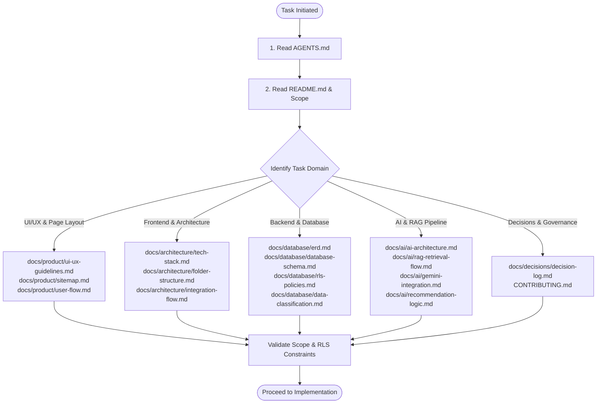

# AGENTS.md — AI Coding Agent Operating System & Repository Guide

> **Target Audience**: AI Coding Agents (Antigravity, Cursor, Claude Code, GitHub Copilot, Gemini CLI, etc.)  
> **Repository**: `hybrid-campus-platform` (Campus Compass)  
> **Status**: Active & Mandatory  
> **Version**: 1.0.0  
> **Last Updated**: 2026-11-20

---

## 1. Project Context & Mission

We are building a **hybrid campus-based student platform** (working title: *Campus Compass*). The application bridges broad student-life insights with high-context, university- and study-program-specific academic knowledge.

### Initial MVP Scope (Strictly Enforced)
- **Pilot Scope**: Exactly **1 pilot university** and **1 study program**.
- **Platform**: Web-based application (responsive desktop and mobile web).
- **Core Knowledge Architecture**: A **hybrid model**:
  1. *General Knowledge*: Broad student life, study strategies, career prep, and general collegiate advice accessible across campuses.
  2. *Campus/Program-Scoped Knowledge*: Academic regulations, course syllabus tips, campus facilities, faculty nuances, and practical student insights strictly scoped to the pilot institution and program.
- **Data Grounding**:
  - Real qualitative data: Student survey responses via Google Forms and user research feedback.
  - Development data: **Clearly labeled synthetic data** for prototyping, mocking, and RAG testing.
- **Architectural Tenet**: Clean, tenant-aware design prepared for multi-campus expansion without overengineering the single-pilot MVP.

---

## 2. Mandatory Agent Rules

Every AI agent working within this repository **MUST** adhere to the following 13 rules without exception:

1. **Read AGENTS.md First**: Always read this file before formulating plans, executing commands, or editing files.
2. **Read Domain Documentation**: Read the relevant domain document (e.g., `docs/database/*`, `docs/architecture/*`, `docs/product/*`) before modifying any code.
3. **Never Invent Requirements or Technical Decisions**: If a requirement, database column, API parameter, or UI design is not documented, do not make assumptions. Flag it as an open question or document a proposal in `docs/decisions/decision-log.md`.
4. **Respect the Agreed Pilot Scope**: Never generate features for multi-tenant billing, multi-university onboarding self-service, or native mobile apps unless explicitly approved in an ADR.
5. **Enforce Tenant & Privacy Boundaries**: Never expose private user data or campus-scoped knowledge through public, unauthenticated, or unscoped endpoints.
6. **Strict Supabase RLS Adherence**: Every database table must have Row Level Security (RLS) enabled. Never propose queries or service-role bypasses that violate security policies.
7. **Zero Secrets in Code**: Never hardcode API keys, service tokens, database passwords, or personal credentials into source code, documentation, or commits.
8. **Use Environment Variables**: Always reference configuration via documented environment variables (`.env.example`).
9. **Architectural Consistency**: Keep all implementation strictly aligned with the documented folder structure, tech stack, and API contracts.
10. **Flag Documentation Conflicts**: If two documentation files contradict each other, explicitly notify the team and file an issue or entry in `docs/decisions/decision-log.md`. Do not silently pick an interpretation.
11. **Update Documentation on Approved Changes**: When an architectural or product decision is approved, update the corresponding documentation files immediately.
12. **Preserve Team Ownership**: Do not overwrite another team member's domain responsibilities without explicit coordination.
13. **Strict Synthetic Data Segregation**: Never treat synthetic data as real interview findings. Keep synthetic fixtures clearly tagged with `[SYNTHETIC]` metadata.

---

## 3. Team Responsibilities & Ownership Matrix

This repository enforces strict domain ownership. Defer to the designated owner for each domain:

| Team Member | Role | Core Domain & Documentation Owned |
| :--- | :--- | :--- |
| **Rifal** | Product & UI/UX Direction | Design system, visual style, moodboards, color palette, typography, visual references, `docs/product/ui-ux-guidelines.md`, `assets/moodboard/`, `assets/references/` |
| **Kalya** | Frontend & User Experience | User flows, sitemaps, Next.js routing structure, page layouts, component UI implementation, `docs/product/sitemap.md`, `docs/product/user-flow.md`, `docs/architecture/folder-structure.md` (co-owner) |
| **Erick** | Technical Setup & AI-Assisted Dev | Tech stack, project scaffolding, coding conventions, integration flows, RAG retrieval pipeline, Gemini API specs, `docs/architecture/tech-stack.md`, `docs/architecture/folder-structure.md` (co-owner), `docs/architecture/integration-flow.md`, `docs/ai/rag-retrieval-flow.md`, `docs/ai/gemini-integration.md` |
| **Netta** | Backend, Database & AI Architecture | Database schema, ERD, RLS policies, data classification, repository governance, API contracts, rule-based recommendation logic, `docs/database/*`, `docs/architecture/api-contract.md`, `docs/ai/recommendation-logic.md` |

---

## 4. Documentation Map & Reading Order

When tasked with a feature or bug fix, navigate to the relevant documents in this order:

### Detailed Document Index
- **Project Foundation**:
  - [`README.md`](README.md): High-level overview, quick start, and directory structure.
  - [`CONTRIBUTING.md`](CONTRIBUTING.md): Git branching, PR guidelines, and commit standards.
  - [`docs/00-project-overview.md`](docs/00-project-overview.md): High-level mission and problem statement.
  - [`docs/01-product-scope.md`](docs/01-product-scope.md): MVP boundary, in-scope vs. out-of-scope details.
  - [`docs/02-team-responsibilities.md`](docs/02-team-responsibilities.md): Team boundaries and RACI matrix.
  - [`docs/03-user-research.md`](docs/03-user-research.md): Research methodology and synthetic data rules.
- **Product & UX**:
  - [`docs/product/product-requirements.md`](docs/product/product-requirements.md): Functional and non-functional requirements.
  - [`docs/product/user-personas.md`](docs/product/user-personas.md): Target user profiles for the pilot.
  - [`docs/product/sitemap.md`](docs/product/sitemap.md): Page routing and information architecture.
  - [`docs/product/user-flow.md`](docs/product/user-flow.md): Step-by-step user journey diagrams.
  - [`docs/product/ui-ux-guidelines.md`](docs/product/ui-ux-guidelines.md): Visual direction and component constraints.
- **Architecture & Integration**:
  - [`docs/architecture/system-architecture.md`](docs/architecture/system-architecture.md): End-to-end system topology.
  - [`docs/architecture/tech-stack.md`](docs/architecture/tech-stack.md): Framework, runtime, and library decisions.
  - [`docs/architecture/folder-structure.md`](docs/architecture/folder-structure.md): Target codebase layout.
  - [`docs/architecture/api-contract.md`](docs/architecture/api-contract.md): Endpoint specifications and JSON schemas.
  - [`docs/architecture/integration-flow.md`](docs/architecture/integration-flow.md): Client-to-DB-to-AI lifecycle.
- **Database & Security**:
  - [`docs/database/erd.md`](docs/database/erd.md): Entity relationships and diagram.
  - [`docs/database/database-schema.md`](docs/database/database-schema.md): Table definitions and constraints.
  - [`docs/database/rls-policies.md`](docs/database/rls-policies.md): Supabase Row Level Security rules.
  - [`docs/database/data-classification.md`](docs/database/data-classification.md): Tiered data isolation criteria.
- **AI & Intelligent Systems**:
  - [`docs/ai/ai-architecture.md`](docs/ai/ai-architecture.md): AI subsystem design.
  - [`docs/ai/rag-retrieval-flow.md`](docs/ai/rag-retrieval-flow.md): Embedding, chunking, and similarity search.
  - [`docs/ai/gemini-integration.md`](docs/ai/gemini-integration.md): Google Gemini API prompts and configuration.
  - [`docs/ai/recommendation-logic.md`](docs/ai/recommendation-logic.md): Deterministic rule engine and student matching.
- **Governance**:
  - [`docs/decisions/decision-log.md`](docs/decisions/decision-log.md): Architectural Decision Records (ADRs).

---

## 5. Protocol for Undocumented Requirements

If a feature, technical choice, or user scenario is **NOT** explicitly covered in existing documentation:

1. **HALT**: Do not invent a solution or introduce arbitrary libraries/schemas.
2. **CLASSIFY**: Determine which team member owns the affected domain (Rifal, Kalya, Erick, or Netta).
3. **LOG**: Create a proposal entry in [`docs/decisions/decision-log.md`](docs/decisions/decision-log.md) marking its status as `Proposed`.
4. **NOTIFY**: Highlight the open question in your response to the user with specific trade-offs and options.

---

## 6. How to Update Documentation

When an architectural decision or product requirement is approved by the team:

1. Record an ADR in [`docs/decisions/decision-log.md`](docs/decisions/decision-log.md) with status `Approved`.
2. Update the primary domain document (e.g. `docs/database/database-schema.md` for schema updates).
3. If the change impacts other layers (e.g., schema changes affecting API contracts or frontend types), update the corresponding secondary documents in the same commit.
4. Verify all markdown cross-links remain valid.

---

## 7. Current Project Phase: Documentation & Preparation Only

> [!IMPORTANT]
> The repository is currently in the **Documentation & Foundation Phase**.
> **DO NOT** generate application code inside `src/` until the initial architecture, database schema, and UI guidelines are formally signed off by the team owners.
