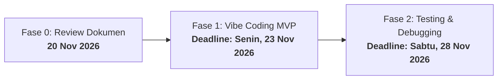

# Campus Compass — Hybrid Campus Student Platform

> **Status**: Documentation & Architecture Approved (Ready for Vibe Coding)  
> **Repository**: `hybrid-campus-platform`  
> **Deadline Vibe Coding MVP**: Senin, 23 November 2026  
> **Deadline Testing & QA**: Sabtu, 28 November 2026  
> **Kanban Jira**: [campuscompassstack2026.atlassian.net](https://campuscompassstack2026.atlassian.net/jira/software/projects/KAN/boards/1)

---

## 1. Executive Summary

**Campus Compass** adalah platform navigasi dan asisten mahasiswa cerdas berbasis web yang memadukan pengetahuan umum kehidupan perkuliahan dengan regulasi akademik spesifik universitas dan program studi.

Platform ini menggunakan **model pengetahuan hybrid (Dual-Layer Knowledge)**:
1. **General Domain Knowledge**: Strategi belajar, penulisan akademik, kesehatan mental, dan persiapan karir universal.
2. **Campus- & Program-Scoped Knowledge**: Prasyarat matakuliah, regulasi akademik, prosedur lab, dan tips praktis yang dikurasi dari survei mahasiswa program studi pilot.

---

## 2. Ruang Lingkup MVP (Strict Pilot Scope)

- **1 Pilot University**: Uji coba terarah pada 1 universitas.
- **1 Study Program**: Uji coba terarah pada 1 program studi.
- **Web-Based**: Responsif di desktop dan mobile web.
- **Fitur Utama**:
  - Autentikasi mahasiswa dengan penguncian konteks prodi & semester.
  - Asisten AI berbasis RAG dengan sitasi sumber dokumen rujukan resmi.
  - Kartu rekomendasi milestone akademik semester (rule-based).
  - Repositori tips kehidupan kampus hasil survei Google Form mahasiswa.
  - Personal workspace (riwayat chat, bookmark, checklist progress, upvote tips, kontribusi tips anonim).

---

## 3. Pembagian Peran Tim

| Anggota Tim | Peran | Fokus Utama |
| :--- | :--- | :--- |
| **Rifal** | Product & UI/UX Direction | Visi produk, storytelling video, visual style, moodboard & panduan UI/UX. |
| **Kalya** | Frontend & User Experience | Sitemap, alur pengguna (user flow), dan implementasi antarmuka Next.js. |
| **Erick** | Technical Setup & AI Dev | Konfirmasi tech stack, pipeline RAG, integrasi Google Gemini API. |
| **Netta** | Backend, Database & AI Architecture | Skema database PostgreSQL, pgvector, Supabase RLS, API contract & rule engine. |

---

## 4. Struktur Repositori Inti (The Lean Spec)

```
hybrid-campus-platform/
├── AGENTS.md                          # Master Prompt & Guardrails untuk AI Coding Agent
├── README.md                          # Ringkasan proyek & status kanban
├── CONTRIBUTING.md                    # Panduan branching Git & commit convention
├── .env.example                       # Template konfigurasi environment variable
├── docs/
│   ├── PRODUCT_SPEC.md                # Spesifikasi lengkap produk, sistem akun, roadmap & data protection
│   ├── TECH_AND_DATABASE.md           # Tech stack, DDL SQL Supabase, RLS & Gemini RAG specs
│   └── TEAM_ASSESSMENT_GUIDE.md       # Panduan review & checklist assessment per anggota tim
├── assets/
│   ├── moodboard/                     # Aset palet warna & visual theme (Rifal)
│   ├── references/                    # Benchmark UI dashboard & mobile drawer (Rifal & Kalya)
│   └── diagrams/                      # Ekspor diagram arsitektur & flow (Erick & Netta)
├── research/
│   ├── interview-notes/               # Rekap respon survei Google Form mahasiswa teranonimkan
│   ├── findings/                      # Rangkuman temuan & affinity mapping riset
│   └── synthetic-data/                # Mock fixture terisolasi untuk unit testing ([SYNTHETIC])
└── src/                               # Tempat kode aplikasi Next.js (Mulai Vibe Coding 23 Nov)
```

---

## 5. Dokumentasi Inti untuk Vibe Coding

| Kebutuhan | Dokumen Acuan | Keterangan |
| :--- | :--- | :--- |
| **Biar Produk Gak Goyah** | [`docs/PRODUCT_SPEC.md`](docs/PRODUCT_SPEC.md) | Batasan scope, sistem akun, privasi, dan alur fitur. |
| **Biar Kode & Data Gak Goyah** | [`docs/TECH_AND_DATABASE.md`](docs/TECH_AND_DATABASE.md) | DDL SQL Supabase lengkap, RPC pgvector, prompt Gemini, struktur `src/`. |
| **Review Tim Sebelum Coding** | [`docs/TEAM_ASSESSMENT_GUIDE.md`](docs/TEAM_ASSESSMENT_GUIDE.md) | Checklist pengecekan spesifik untuk Rifal, Kalya, Erick, dan Netta. |
| **Instruksi Coding Agent** | [`AGENTS.md`](AGENTS.md) | Master prompt hemat token untuk coding assistant. |

---

## 6. Timeline & Target Selesai


