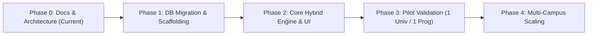

# Campus Compass — Hybrid Campus Student Platform

> **Status**: Documentation & Architecture Phase (Pre-Development)  
> **Repository**: `hybrid-campus-platform`  
> **Primary Contact**: Netta (Backend & Repo Lead), Erick (Technical Lead), Kalya (Frontend Lead), Rifal (Product & UI/UX Lead)

---

## 1. Executive Summary

**Campus Compass** is an intelligent, web-based student navigation platform designed to bridge the gap between general academic preparedness and hyper-local, campus-specific knowledge. 

Freshman and continuing university students frequently face fragmented sources of truth: university policies are scattered across static PDF handbooks, course selection insights live in unindexed WhatsApp or Telegram groups, and informal collegiate advice is passed down unevenly across student circles.

Campus Compass addresses this with a **hybrid knowledge architecture**:
1. **General Domain Knowledge**: Universal study strategies, academic writing guidelines, mental health awareness, and early career preparation accessible across universities.
2. **Campus- & Program-Scoped Knowledge**: Course syllabi nuances, lecturer expectations, credit transfer rules, campus facilities, and practical student tips strictly scoped to specific institutions and study programs.

---

## 2. Initial MVP Scope

To maximize velocity and qualitative validation while avoiding premature optimization, our initial launch strictly adheres to the following boundaries:

- **1 Pilot University**: Single institution pilot.
- **1 Study Program**: Single academic department.
- **Form Factor**: Web-based application (responsive across modern desktop and mobile browsers).
- **Core Capabilities**:
  - Secure student authentication with university/program context assignment.
  - Dual-layer knowledge browsing and search.
  - Hybrid RAG (Retrieval-Augmented Generation) query interface with source citations.
  - Deterministic, rule-based recommendation cards for student onboarding.
  - Curated student insights and campus survival guides.
- **Data Grounding**:
  - Real student interviews for qualitative context.
  - Formally isolated, clearly labeled synthetic datasets for schema validation, RAG testing, and UI mocking.

---

## 3. Team Ownership & Responsibilities

| Team Member | Role | Core Focus Area | Primary Documentation |
| :--- | :--- | :--- | :--- |
| **Rifal** | Product & UI/UX Direction | Visual identity, moodboards, typography, component references, storytelling | [`docs/product/ui-ux-guidelines.md`](docs/product/ui-ux-guidelines.md), `assets/moodboard/`, `assets/references/` |
| **Kalya** | Frontend & User Experience | User journey, page routing, sitemaps, Next.js page layouts, interactive UI | [`docs/product/sitemap.md`](docs/product/sitemap.md), [`docs/product/user-flow.md`](docs/product/user-flow.md), [`docs/architecture/folder-structure.md`](docs/architecture/folder-structure.md) |
| **Erick** | Technical Setup & AI Dev | Tech stack, project setup, integration flows, RAG retrieval pipeline, Gemini specs | [`docs/architecture/tech-stack.md`](docs/architecture/tech-stack.md), [`docs/architecture/integration-flow.md`](docs/architecture/integration-flow.md), [`docs/ai/rag-retrieval-flow.md`](docs/ai/rag-retrieval-flow.md), [`docs/ai/gemini-integration.md`](docs/ai/gemini-integration.md) |
| **Netta** | Backend, DB & AI Architecture | Database schema, ERD, Supabase RLS, API contracts, rule-based recommendation logic | [`docs/database/erd.md`](docs/database/erd.md), [`docs/database/database-schema.md`](docs/database/database-schema.md), [`docs/database/rls-policies.md`](docs/database/rls-policies.md), [`docs/architecture/api-contract.md`](docs/architecture/api-contract.md), [`docs/ai/recommendation-logic.md`](docs/ai/recommendation-logic.md) |

---

## 4. Repository Structure

```
hybrid-campus-platform/
├── AGENTS.md                          # Mandatory instructions for AI coding agents
├── README.md                          # Project overview and navigation
├── CONTRIBUTING.md                    # Git workflows, branching, and PR rules
├── .gitignore                         # Environment, build, and OS ignores
├── docs/
│   ├── 00-project-overview.md         # Problem statement, mission, and success metrics
│   ├── 01-product-scope.md            # Pilot boundaries, in-scope vs out-of-scope
│   ├── 02-team-responsibilities.md    # Detailed RACI matrix and handoff protocols
│   ├── 03-user-research.md            # Student interview guide & synthetic data rules
│   ├── product/
│   │   ├── product-requirements.md    # Functional & non-functional requirements
│   │   ├── user-personas.md           # Pilot persona profiles
│   │   ├── sitemap.md                 # Route mapping and page hierarchy
│   │   ├── user-flow.md               # User journey flowcharts
│   │   └── ui-ux-guidelines.md        # Design tokens, moodboard, and visual styling
│   ├── architecture/
│   │   ├── system-architecture.md     # High-level architecture and subsystem diagram
│   │   ├── tech-stack.md              # Proposed & confirmed technology stack
│   │   ├── folder-structure.md        # Target Next.js application directory tree
│   │   ├── api-contract.md            # REST / RPC endpoint contracts and schemas
│   │   └── integration-flow.md        # End-to-end data lifecycle
│   ├── database/
│   │   ├── erd.md                     # Entity-Relationship Diagram (Mermaid)
│   │   ├── database-schema.md         # PostgreSQL table definitions & constraints
│   │   ├── rls-policies.md            # Supabase Row Level Security definitions
│   │   └── data-classification.md     # Tiered data privacy and scoping criteria
│   ├── ai/
│   │   ├── ai-architecture.md         # AI subsystem design & guardrails
│   │   ├── rag-retrieval-flow.md      # Hybrid vector search, chunking & citations
│   │   ├── gemini-integration.md      # Google Gemini API configuration & prompt specs
│   │   └── recommendation-logic.md    # Rule engine and student matching heuristics
│   └── decisions/
│       └── decision-log.md            # Architectural Decision Records (ADRs)
├── assets/
│   ├── moodboard/                     # UI visual references and color explorations
│   ├── references/                    # Design benchmarks and competitor screenshots
│   └── diagrams/                      # System diagrams and exported assets
├── research/
│   ├── interview-notes/               # Qualitative notes from student interviews
│   ├── findings/                      # Synthesized research insights
│   └── synthetic-data/                # Clearly tagged test datasets
└── src/                               # Application source code (Placeholder for Phase 1)
```

---

## 5. Documentation Navigation Matrix

| Domain | Start Here | Supporting Documents |
| :--- | :--- | :--- |
| **For AI Coding Agents** | [`AGENTS.md`](AGENTS.md) | [`docs/decisions/decision-log.md`](docs/decisions/decision-log.md) |
| **Project & Strategy** | [`docs/00-project-overview.md`](docs/00-project-overview.md) | [`docs/01-product-scope.md`](docs/01-product-scope.md), [`docs/02-team-responsibilities.md`](docs/02-team-responsibilities.md) |
| **Design & Product** | [`docs/product/product-requirements.md`](docs/product/product-requirements.md) | [`docs/product/user-personas.md`](docs/product/user-personas.md), [`docs/product/sitemap.md`](docs/product/sitemap.md), [`docs/product/ui-ux-guidelines.md`](docs/product/ui-ux-guidelines.md) |
| **Architecture & Dev** | [`docs/architecture/system-architecture.md`](docs/architecture/system-architecture.md) | [`docs/architecture/tech-stack.md`](docs/architecture/tech-stack.md), [`docs/architecture/folder-structure.md`](docs/architecture/folder-structure.md), [`docs/architecture/integration-flow.md`](docs/architecture/integration-flow.md) |
| **Database & Security** | [`docs/database/erd.md`](docs/database/erd.md) | [`docs/database/database-schema.md`](docs/database/database-schema.md), [`docs/database/rls-policies.md`](docs/database/rls-policies.md), [`docs/database/data-classification.md`](docs/database/data-classification.md) |
| **AI & Retrieval** | [`docs/ai/ai-architecture.md`](docs/ai/ai-architecture.md) | [`docs/ai/rag-retrieval-flow.md`](docs/ai/rag-retrieval-flow.md), [`docs/ai/gemini-integration.md`](docs/ai/gemini-integration.md), [`docs/ai/recommendation-logic.md`](docs/ai/recommendation-logic.md) |

---

## 6. Development Status & Roadmap



- **Phase 0 (Current)**: Central documentation repository, architectural specifications, schema blueprints, and AI agent operating guardrails.
- **Phase 1**: Database provisioning (Supabase), RLS policy validation, Next.js application scaffolding, and base UI component setup.
- **Phase 2**: Dual-layer knowledge ingestion, vector search pipeline, Gemini API RAG flow, and recommendation logic.
- **Phase 3**: Qualitative testing with pilot cohort (1 university, 1 program), interview validation, and feedback iterations.
- **Phase 4**: Expansion to additional faculties and external campuses using proven tenant isolation.

---

## 7. Contributing & AI Agent Compliance

- Before committing or modifying any file, read [`CONTRIBUTING.md`](CONTRIBUTING.md).
- AI coding agents must read and adhere to [`AGENTS.md`](AGENTS.md).
