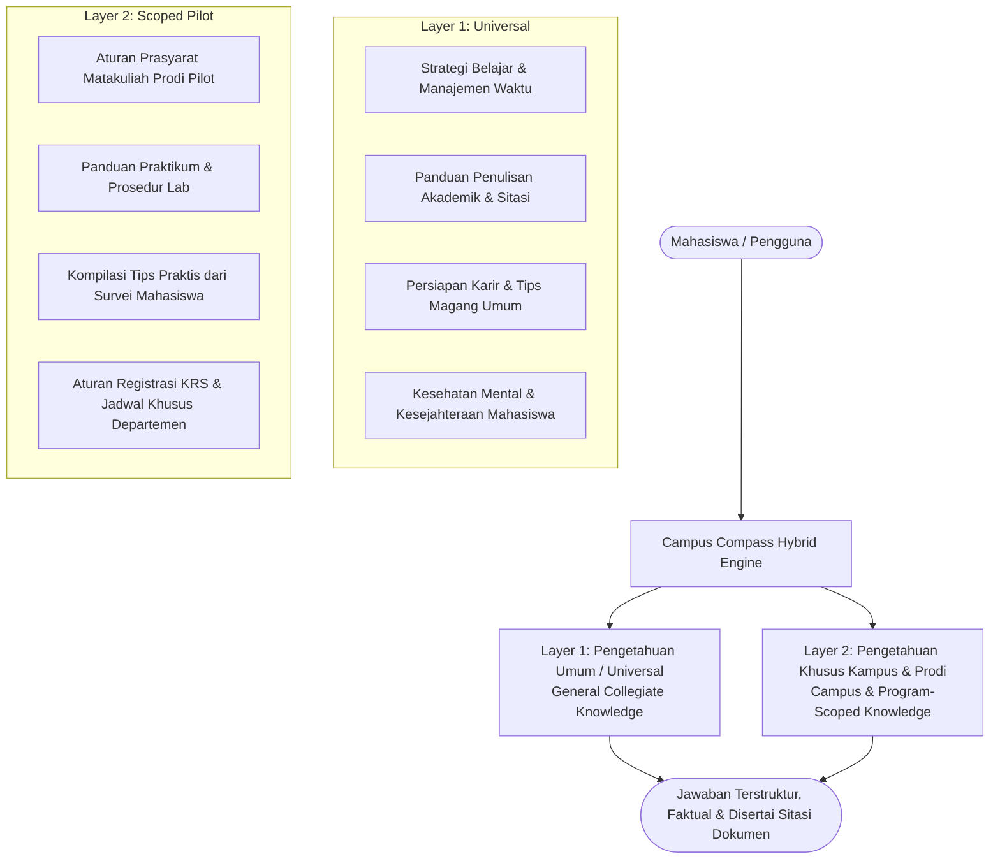

# 00 — Project Overview

> **Dokumen**: `docs/00-project-overview.md`  
> **Owner**: Seluruh Tim (Koordinator: Netta)  
> **Status**: Baseline Approved (Foundation Phase)  
> **Last Updated**: 2026-11-20  
> **Dependencies**: [`docs/01-product-scope.md`](01-product-scope.md), [`docs/02-team-responsibilities.md`](02-team-responsibilities.md)

---

## 1. Tujuan Dokumen

Dokumen ini menyajikan informasi dasar (baseline) mengenai latar belakang, rumusan masalah, visi platform, serta metrik keberhasilan **Campus Compass** (Hybrid Campus Student Platform). Dokumen ini menjadi pedoman bersama bagi seluruh anggota tim dan coding agent sebelum implementasi aplikasi dimulai.

---

## 2. Latar Belakang & Rumusan Masalah

Kehidupan perkuliahan sering kali memberikan beban adaptasi dan kebingungan informasi yang tinggi bagi mahasiswa, terutama mahasiswa baru maupun mahasiswa yang sedang menjalani masa transisi akademik:

1. **Informasi Akademik yang Terfragmentasi**:
   - Peraturan akademik, prasyarat matakuliah (prerequisite), dan alur kelulusan sering kali tertimbun di dalam buku pedoman PDF tebal (100+ halaman) yang sulit dicari informasinya secara cepat.
   - Pengumuman fakultas tersebar di portal-portal web yang kaku, jarang diperbarui, atau terpisah-pisah antar-subdomain.
2. **Ketergantungan pada Informasi Ephemeral di Grup Chat**:
   - Informasi praktis seputar tips memilih dosen, mekanisme praktikum laboratorium, dan survival advice kampus biasanya hanya beredar di grup obrolan informal (WhatsApp / Telegram) yang cepat tenggelam dan sulit diakses oleh mahasiswa yang belum memiliki jaringan pertemanan luas.
3. **Keterbatasan AI Generik**:
   - Menggunakan chatbot AI publik (seperti ChatGPT atau Gemini biasa) sering kali menghasilkan jawaban yang salah atau berhalusinasi, karena model umum tidak mengetahui peraturan kurikulum spesifik, kalender akademik lokal, dan kebijakan unik departemen/program studi tertentu.

---

## 3. Visi & Solusi Produk (Campus Compass)

**Campus Compass** hadir sebagai asisten cerdas navigasi mahasiswa yang menggabungkan kemudahan pencarian interaktif dengan **arsitektur pengetahuan hybrid (Dual-Layer Knowledge Model)**:

### Keunggulan Utama
- **Grounding Faktual & Anti-Halusinasi**: Jawaban AI selalu merujuk pada dokumen resmi dan hasil kurasi survei kampus dengan mencantumkan sitasi sumber yang dapat diklik.
- **Pemisahan Konteks yang Jelas**: Menampilkan label pembeda antara tips umum yang berlaku lintas kampus dengan aturan yang spesifik berlaku di kampus/prodi pengguna.
- **Rekomendasi Deterministik**: Milestone penting akademik (misal: induksi lab, pengajuan KRS) dikelola dengan aturan pasti (rule-based) agar tidak terjadi kesalahan arahan.

---

## 4. Ruang Lingkup Pilot Awal

Untuk menjaga fokus dan kualitas validasi data awal tanpa overengineering:
- **1 Universitas Pilot**: Uji coba pada 1 institusi pendidikan tinggi.
- **1 Program Studi Pilot**: Uji coba pada 1 departemen/program studi spesifik.
- **Platform**: Web application responsif yang dapat diakses optimal melalui peramban ponsel dan komputer desktop.
- **Sumber Data Riset Awal**: Kuesioner survei daring via **Google Forms** kepada mahasiswa, dikombinasikan dengan data sintetis mock yang terlabel rapi untuk kebutuhan pengujian teknis.

---

## 5. Indikator Keberhasilan (Baseline KPIs)

1. **Akurasi & Sitasi**: 100% jawaban AI untuk regulasi kampus menyertakan referensi sumber dokumen rujukan.
2. **Efisiensi Pencarian**: Mahasiswa dapat menemukan jawaban atas aturan prodi dalam waktu kurang dari 10 detik tanpa harus membaca tumpukan PDF manual.
3. **Kepuasan Pengguna**: Skor kegunaan (usability) dan relevansi tips di atas rata-rata berdasarkan survei evaluasi mahasiswa pilot.

---

## 6. Referensi & Dokumen Terkait

- [`docs/01-product-scope.md`](01-product-scope.md): Rincian batasan in-scope dan out-of-scope MVP.
- [`docs/02-team-responsibilities.md`](02-team-responsibilities.md): Pembagian peran dan matriks tim.
- [`docs/03-user-research.md`](03-user-research.md): Metodologi riset survei Google Form.
- [`AGENTS.md`](../AGENTS.md): Panduan kepatuhan operasional coding agent.
