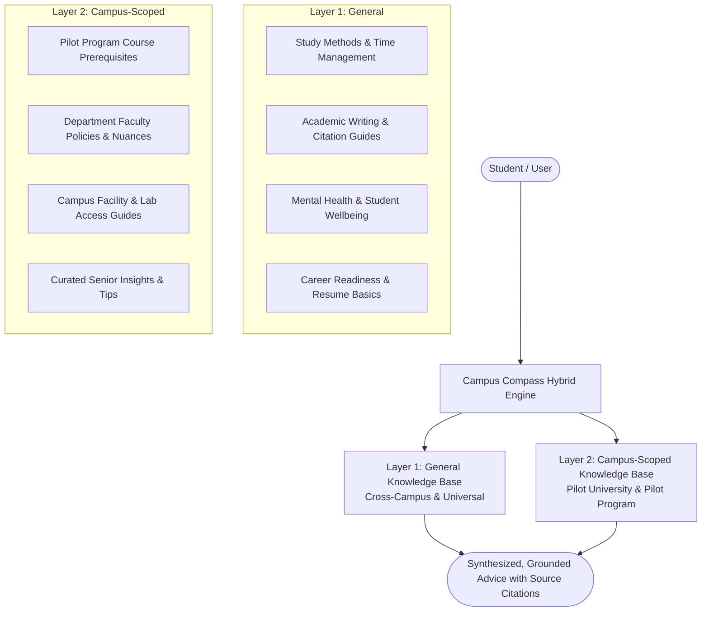

# 00 — Project Overview

> **Document**: `docs/00-project-overview.md`  
> **Owner**: Full Team (Coordinated by Netta)  
> **Status**: Approved (Foundation Phase)  
> **Last Updated**: 2026-11-20  
> **Dependencies**: [`docs/01-product-scope.md`](01-product-scope.md), [`docs/02-team-responsibilities.md`](02-team-responsibilities.md)

---

## 1. Purpose

This document articulates the overarching vision, problem statement, core value proposition, and success criteria for **Campus Compass** (Hybrid Campus Student Platform). It serves as the strategic orientation for all human team members and AI coding agents.

---

## 2. Problem Statement

University life presents students—particularly first-year students and transfer candidates—with high cognitive overload and information fragmentation:

1. **Siloed Bureaucracy**: Vital information regarding academic prerequisites, credit transfers (SKS), graduation requirements, and institutional deadlines is buried in static, unsearchable PDF handbooks or obsolete faculty subdomains.
2. **Informal & Ephemeral "Tribal Knowledge"**: Crucial practical advice—such as which professors prefer specific submission formats, how to secure research assistantships, or where affordable student housing exists—resides exclusively in ephemeral WhatsApp/Telegram group chats.
3. **Generic AI Shortcomings**: Public LLMs (e.g., vanilla ChatGPT or Gemini) lack knowledge of specific university regulations, local academic calendars, and department-level nuances. Consequently, generic AI queries generate inaccurate or misleading advice.
4. **Isolation in Transition**: First-generation and newly relocated students lack established senior networks, putting them at a severe disadvantage in academic performance and campus navigation.

---

## 3. Product Vision & Solution

**Campus Compass** is an AI-augmented student copilot built on a **hybrid knowledge model**:

### Key Differentiators
- **Grounded Dual-Layer Retrieval**: Combines universal higher-education best practices with verified, pilot-specific academic guidelines.
- **Strict Tenant & Department Scoping**: Eliminates cross-campus contamination while preserving reusable core architecture.
- **Senior-Grounded Content**: Qualitative insights gathered from senior student interviews, providing actionable, authentic guidance.
- **Rule-Guided Safety**: Deterministic heuristics ensure compliance with academic rules before generative AI delivers personalized answers.

---

## 4. Pilot Implementation Strategy

To deliver immediate value without premature complexity:
- **Pilot Scope**: Exactly **1 pilot university** and **1 study program**.
- **Delivery Channel**: Responsive web application accessible on desktop and mobile browsers.
- **Validation Focus**: Validate user engagement, citation accuracy, and perceived student trust within a controlled academic cohort before multi-campus scaling.

---

## 5. Confirmed vs. Proposed Decisions

### Confirmed Decisions
- [x] Initial release targets exactly 1 university and 1 study program.
- [x] Application is web-based.
- [x] Knowledge retrieval must separate general domain data from campus-scoped data.
- [x] Development and prototyping use strictly segregated, clearly labeled synthetic data.

### Proposed Decisions (Pending Owner Confirmation)
- [ ] Primary pilot candidate institution and specific department (Owner: Rifal / Netta).
- [ ] Core color palette and visual design system (Owner: Rifal).
- [ ] Database hosting and deployment infrastructure configuration (Owner: Netta / Erick).

---

## 6. Open Questions

1. Which specific university and study program will serve as the pilot partner?
2. What are the formal data governance permissions for ingesting official department syllabi?
3. What quantitative target metric represents success for the pilot (e.g., weekly active students, query resolution rate)?
