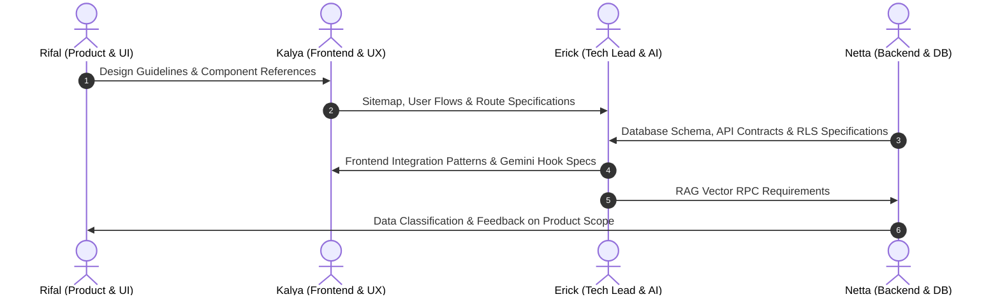

# 02 — Team Responsibilities & RACI Matrix

> **Document**: `docs/02-team-responsibilities.md`  
> **Owner**: Full Team  
> **Status**: Approved (Foundation Phase)  
> **Last Updated**: 2026-11-20  
> **Dependencies**: [`AGENTS.md`](../AGENTS.md), [`docs/00-project-overview.md`](00-project-overview.md)

---

## 1. Purpose

This document establishes the official ownership, responsibility boundaries, and decision-making authority across the four team members. No AI agent or human contributor may reassign responsibilities without explicit team consensus.

---

## 2. Team Member Ownership Breakdown

### A. Rifal — Product & UI/UX Direction
- **Core Domain**: Visual design, user experience design system, brand storytelling.
- **Key Responsibilities**:
  - Conceptualizing product video narrative and storytelling flow.
  - Curating and maintaining UI/UX moodboards: color palette, typography, visual hierarchy.
  - Designing dashboard, landing page, and interactive visual references.
  - Establishing design tokens and component inspiration.
  - Overseeing visual assets in `assets/moodboard/` and `assets/references/`.
- **Primary Deliverables**:
  - [`docs/product/ui-ux-guidelines.md`](product/ui-ux-guidelines.md)
  - Asset galleries in `assets/moodboard/` and `assets/references/`

### B. Kalya — Frontend & User Experience
- **Core Domain**: Frontend architecture, user journeys, navigation flow, and screen layouts.
- **Key Responsibilities**:
  - Defining the complete web sitemap and route hierarchy.
  - Mapping step-by-step user flows (onboarding, search, knowledge retrieval).
  - Architecting the Next.js App Router layout and navigation structure.
  - Translating Rifal's UI/UX guidelines into accessible, responsive React components.
- **Primary Deliverables**:
  - [`docs/product/sitemap.md`](product/sitemap.md)
  - [`docs/product/user-flow.md`](product/user-flow.md)
  - [`docs/architecture/folder-structure.md`](architecture/folder-structure.md) (Co-owner with Erick)

### C. Erick — Technical Setup & AI-Assisted Development
- **Core Domain**: Technical stack, integration engineering, and AI retrieval pipelines.
- **Key Responsibilities**:
  - Validating and maintaining the core tech stack specification.
  - Scaffolding the initial project architecture and defining coding conventions.
  - Managing frontend-to-backend integration patterns.
  - Engineering the RAG retrieval pipeline (chunking, vector search, context assembly).
  - Authoring the Google Gemini API integration specification.
- **Primary Deliverables**:
  - [`docs/architecture/tech-stack.md`](architecture/tech-stack.md)
  - [`docs/architecture/folder-structure.md`](architecture/folder-structure.md) (Co-owner with Kalya)
  - [`docs/architecture/integration-flow.md`](architecture/integration-flow.md)
  - [`docs/ai/rag-retrieval-flow.md`](ai/rag-retrieval-flow.md)
  - [`docs/ai/gemini-integration.md`](ai/gemini-integration.md)

### D. Netta — Backend, Database & AI Architecture
- **Core Domain**: Database schema, security policies, backend architecture, and repository governance.
- **Key Responsibilities**:
  - Designing Entity-Relationship Diagrams (ERD) and relational schemas.
  - Defining authentication flows and data classification (Public, Scoped, Private).
  - Writing and auditing Supabase Row Level Security (RLS) policies.
  - Architecting API contracts and backend RPC functions.
  - Specifying deterministic, rule-based recommendation logic.
  - Overseeing Git repository governance and CI foundation.
- **Primary Deliverables**:
  - [`docs/database/erd.md`](database/erd.md)
  - [`docs/database/database-schema.md`](database/database-schema.md)
  - [`docs/database/rls-policies.md`](database/rls-policies.md)
  - [`docs/database/data-classification.md`](database/data-classification.md)
  - [`docs/architecture/api-contract.md`](architecture/api-contract.md)
  - [`docs/ai/recommendation-logic.md`](ai/recommendation-logic.md)

---

## 3. RACI Matrix

The RACI matrix defines roles for each major project deliverable:
- **R (Responsible)**: The person who does the work to achieve the deliverable.
- **A (Accountable)**: The sole person with final approval and decision authority.
- **C (Consulted)**: Person(s) whose opinions and inputs are sought.
- **I (Informed)**: Person(s) kept updated on progress.

| Deliverable / Artifact | Rifal | Kalya | Erick | Netta |
| :--- | :---: | :---: | :---: | :---: |
| **Product Video Concept & Moodboard** | **A / R** | C | I | I |
| **UI/UX Design Tokens & Style Guide** | **A / R** | C | C | I |
| **Sitemap & User Flows** | C | **A / R** | C | C |
| **Next.js App Routing & UI Components** | C | **A / R** | C | I |
| **Tech Stack & System Architecture** | I | C | **A / R** | C |
| **Folder Structure & Coding Standards** | I | C | **A / R** | C |
| **RAG Pipeline & Gemini API Integration** | I | I | **A / R** | C |
| **Database Schema, ERD & RLS Policies** | I | I | C | **A / R** |
| **API Contracts & Data Classification** | I | C | C | **A / R** |
| **Deterministic Recommendation Rules** | C | C | C | **A / R** |
| **Git Repository Governance & PR Approval** | I | I | C | **A / R** |

---

## 4. Cross-Domain Handoff & Review Workflow

---

## 5. Conflict Resolution Protocol

1. If a technical or product dispute arises between domains (e.g. API payload format between Kalya and Netta):
   - The affected owners must discuss trade-offs directly.
   - The outcome must be logged as an Architectural Decision Record (ADR) in [`docs/decisions/decision-log.md`](decisions/decision-log.md).
2. AI agents **must never** break a tie or invent an unapproved consensus.
