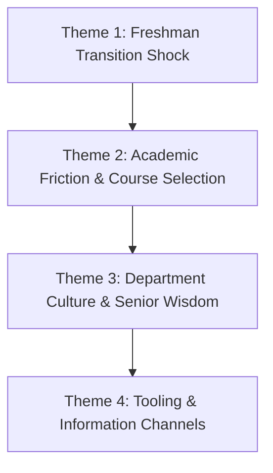

# 03 — User Research & Data Grounding

> **Document**: `docs/03-user-research.md`  
> **Owner**: Rifal & Netta  
> **Status**: Draft (In Progress)  
> **Last Updated**: 2026-11-20  
> **Dependencies**: [`docs/00-project-overview.md`](00-project-overview.md), [`docs/database/data-classification.md`](database/data-classification.md)

---

## 1. Purpose

This document outlines the user research strategy, qualitative data collection protocols, and rigorous rules governing the generation and separation of **synthetic data**.

---

## 2. Research Strategy & Senior Interviews

To ground Campus Compass in genuine student needs rather than theoretical assumptions, our primary discovery channel is structured qualitative interviews with senior students from the pilot study program.

### Key Research Objectives
1. Identify the most critical information bottlenecks experienced during the first two semesters.
2. Uncover the "hidden curriculum"—unwritten expectations regarding academic survival, laboratory culture, and professor communication.
3. Discover which questions senior students are asked most repeatedly by juniors.
4. Validate student willingness to trust an AI-assisted platform for academic advice.

### Target Interview Cohort
- **Cohort Size**: 5–8 senior students (Year 3 / Year 4 or recent graduates) from the pilot study program.
- **Criteria**: Diverse academic tracks, mix of student organization leaders and academic achievers.

---

## 3. Interview Protocol & Question Guide

Interviews are semi-structured, lasting 30–45 minutes, organized around four themes:



### Sample Interview Questions
1. *When you first started in this study program, what was the single most confusing academic policy or requirement?*
2. *If you could give your first-year self one piece of advice regarding course enrollment (KRS/SKS), what would it be?*
3. *What are the unwritten rules of communicating with faculty members in our department?*
4. *Where do students currently go when they have an urgent question about a lab, prerequisite, or exam format?*
5. *What would make you trust an AI-driven academic assistant, and what would immediately destroy your trust in it?*

All raw notes must be anonymized and stored in `research/interview-notes/`.

---

## 4. Synthetic Data Standard & Guardrails

During early prototyping and development, real interview data and official university documents may not yet be fully indexed. We employ **synthetic data** strictly under the following mandatory rules:

### Mandatory Synthetic Rules
1. **Explicit Labeling**: Every synthetic record, JSON fixture, or mock embedding **MUST** be explicitly tagged with metadata:
   ```json
   {
     "is_synthetic": true,
     "data_provenance": "SYNTHETIC_PROTOTYPE_FIXTURE_V1",
     "warning": "NOT FOR PRODUCTION / NOT VERIFIED BY SENIOR INTERVIEW"
   }
   ```
2. **Strict Storage Isolation**: Synthetic datasets must reside solely within `research/synthetic-data/` or test fixture folders. They must never be merged into production database seeds.
3. **Never Treat Synthetic Data as Real Findings**: AI coding agents and team members must never base product requirements, UX decisions, or academic policies on synthetic data.
4. **Content Realism without PII**: Synthetic data should mirror realistic structure (e.g., realistic course codes, typical credit counts) but must not include real student names, actual student IDs (NIM), or personal phone numbers.

---

## 5. Storage Layout in Repository

- `research/interview-notes/`: Anonymized notes from senior student interviews (`.gitkeep`).
- `research/findings/`: Synthesized qualitative insights, affinity maps, and prioritized pain points (`.gitkeep`).
- `research/synthetic-data/`: Clearly tagged JSON/Markdown mock fixtures used for testing RAG chunking and UI rendering (`.gitkeep`).

---

## 6. Open Questions

1. Has the ethical consent form for senior student interview recordings been approved?
2. Which pilot study program has confirmed participation for the interview cohort?
3. How will qualitative quotes from senior students be verified before being surfaced as verified tips in the application?
