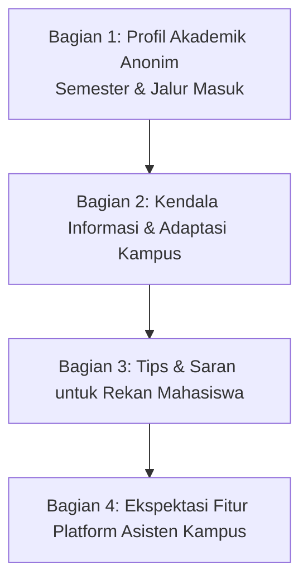

# 03 — User Research & Data Grounding

> **Dokumen**: `docs/03-user-research.md`  
> **Owner**: Rifal & Netta  
> **Status**: Baseline Approved (Foundation Phase)  
> **Last Updated**: 2026-11-20  
> **Dependencies**: [`docs/00-project-overview.md`](00-project-overview.md), [`docs/database/data-classification.md`](database/data-classification.md)

---

## 1. Tujuan Dokumen

Dokumen ini menjelaskan metodologi riset pengguna, instrumen survei kuesioner daring menggunakan **Google Form**, pengelolaan respon data mahasiswa, serta ketentuan ketat mengenai pemisahan **data sintetis (synthetic data)**.

---

## 2. Metodologi Riset: Survei Kuesioner Google Form

Pengumpulan data kualitatif dan kuantitatif mengenai kebutuhan serta kendala mahasiswa dilakukan melalui **survei kuesioner daring via Google Forms** yang disebarkan kepada mahasiswa di program studi dan universitas pilot.

### Tujuan Utama Survei
1. **Identifikasi Information Bottlenecks**: Menemukan informasi apa yang paling sulit didapatkan oleh mahasiswa pada semester-semester awal (aturan KRS, prasyarat matakuliah, prosedur lab).
2. **Pemetaan Jalur Informasi Eksisting**: Mengetahui media apa yang saat ini digunakan mahasiswa untuk mencari jawaban (grup chat WhatsApp/Telegram, bertanya ke kakak tingkat, website kampus).
3. **Inventarisasi Tips & Wawasan Praktis**: Mengumpulkan saran dan tips pengalaman nyata dari mahasiswa yang telah melewati masa penyesuaian perkuliahan.
4. **Validasi Kebutuhan Solusi AI**: Mengukur preferensi mahasiswa terhadap asisten tanya-jawab akademik berbasis kecerdasan buatan.

---

## 3. Instrumen & Struktur Kuesioner Google Form

Kuesioner dirancang ringkas (waktu pengisian 5–7 menit) dengan pembagian bagian:

### Poin Pertanyaan Kunci dalam Google Form
- *Selama berkuliah di program studi ini, peraturan atau prosedur akademik apa yang paling membingungkan bagi Anda?*
- *Di mana Anda biasanya mencari bantuan saat mengalami kendala seputar perkuliahan atau tugas praktikum?*
- *Jika Anda bisa memberikan 1 tips paling berharga untuk rekan mahasiswa baru di prodi ini, apa tips tersebut?*
- *Apakah Anda merasa terbantu jika ada asisten AI yang dapat menjawab aturan akademik lengkap dengan dokumen sumber resminya?*

---

## 4. Pengelolaan & Penyimpanan Data Hasil Survei

- **Ekspor Data Mentah**: Hasil tanggapan dari Google Forms di-export dalam format CSV/Spreadsheet dan disimpan di `research/interview-notes/` (atau direktori respon survei).
- **Anonimisasi Wajib**: Seluruh data respon yang disimpan wajib dibersihkan dari informasi kontak pribadi (nomor HP, email pribadi, atau identitas langsung) guna melindungi privasi responden.
- **Sintesis Temuan**: Rangkuman tema, pengelompokan kendala, dan kutipan tips terpilih diolah ke dalam dokumen temuan di `research/findings/`.

---

## 5. Ketentuan Penggunaan Data Sintetis (Synthetic Data)

Selama pengisian data riil hasil survei Google Form sedang berlangsung, tim pengembang dan AI coding agent menggunakan **data sintetis** dengan aturan ketat:
1. **Label Eksplisit**: Semua file mock wajib mencantumkan tanda pengenal `[SYNTHETIC]` atau metadata `"is_synthetic": true`.
2. **Lokasi Terisolasi**: Disimpan hanya di `research/synthetic-data/` atau fixture pengujian.
3. **Bukan Fakta Riil**: Data sintetis dilarang keras dianggap sebagai hasil survei riil ataupun fakta regulasi kampus yang sebenarnya.
4. **Dilarang Masuk Database Produksi**: Data sintetis tidak boleh dijadikan data awal (seeding) untuk database produksi.

---

## 6. Referensi & Dokumen Terkait

- [`research/interview-notes/README.md`](../research/interview-notes/README.md): Tempat penyimpanan tanggapan survei mahasiswa.
- [`research/findings/README.md`](../research/findings/README.md): Tempat penyimpanan sintesis temuan riset.
- [`research/synthetic-data/README.md`](../research/synthetic-data/README.md): Panduan pemisahan data sintetis.
