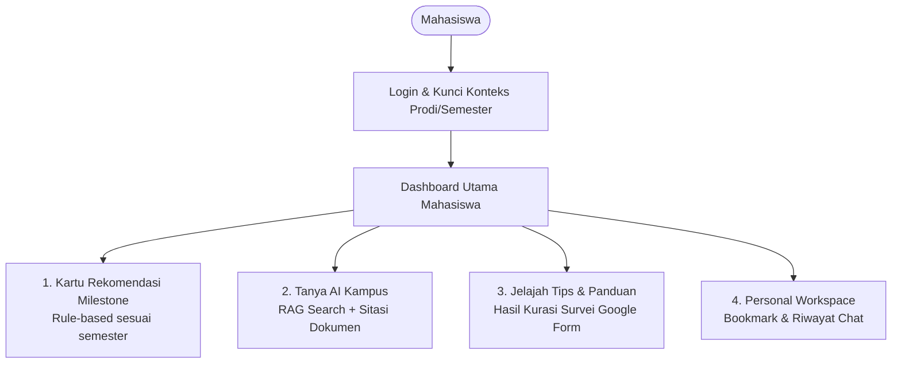

# Campus Compass — Master Product Specification (PRD)

> **Dokumen**: `docs/PRODUCT_SPEC.md`  
> **Status**: Ready for Team Assessment (Phase 0)  
> **Target Vibe Coding**: Selesai Senin, 23 November 2026  
> **Target Debugging & QA**: Selesai Sabtu, 28 November 2026  
> **Repositori**: `hybrid-campus-platform` (Campus Compass)

---

## 1. Ringkasan Eksekutif & Problem Statement

**Campus Compass** adalah platform web asisten navigasi mahasiswa cerdas yang memecahkan masalah fragmentasi informasi akademik di perguruan tinggi.

### Masalah Nyata Mahasiswa:
1. **Regulasi Terkubur di PDF Tebal**: Aturan KRS, prasyarat matakuliah, dan pedoman kelulusan tersimpan di buku pedoman PDF ratusan halaman yang sulit dicari informasinya secara instan.
2. **Informasi Praktis Cepat Tenggelam**: Tips praktikum lab, rekomendasi dosen, dan tips adaptasi kuliah hanya beredar di grup WhatsApp/Telegram yang cepat tertimbun obrolan lain.
3. **AI Publik Sering Halusinasi**: ChatGPT atau Gemini biasa tidak memahami kurikulum lokal program studi dan kalender akademik spesifik universitas, sehingga sering memberi saran yang salah.

### Solusi: Arsitektur Pengetahuan Hybrid (Dual-Layer)
- **Layer 1: General Collegiate Knowledge (Universal)**: Strategi belajar, penulisan akademik/sitasi, manajemen waktu, persiapan magang/karir, dan kesehatan mental yang berlaku umum lintas kampus.
- **Layer 2: Campus & Program-Scoped Knowledge (Lokal)**: Prasyarat matakuliah, regulasi akademik lokal, prosedur lab, dan tips praktis yang dikurasi dari **survei Google Form mahasiswa** program studi pilot.

---

## 2. Ruang Lingkup MVP (Strict Pilot Scope)

Untuk memastikan kecepatan peluncuran (*speed to market*) dan mencegah *scope creep*:
- **Pilot Target**: Tepat **1 Universitas Pilot** dan **1 Program Studi Pilot**.
- **Form Factor**: Web Application responsif (desktop monitor dan mobile browser).
- **Zero Hallucination Policy**: Setiap jawaban AI mengenai regulasi kampus **wajib mencantumkan sitasi sumber dokumen rujukan** yang dapat diklik (*citation pill*).

---

## 3. Sistem Akun: Academic Utility & Personal Workspace

> [!IMPORTANT]
> **Bukan Model Sosial Media Penuh**: Menghindari fitur sosmed bebas seperti follow/followers, timeline feed publik, dan direct message (DM) pribadi agar tidak ada beban moderasi spam/drama dan menjaga mahasiswa fokus pada navigasi akademik.

### Fitur Akun Mahasiswa:
1. **Penguncian Konteks (Context Anchor)**:
   - Login via Supabase Auth (Email & Password).
   - Profil terikat ke: `university_id`, `study_program_id`, dan `semester` berjalan.
   - Konteks ini otomatis menjadi filter pencarian AI dan kartu rekomendasi dashboard.
2. **Personal Workspace**:
   - **Riwayat Chat AI (RAG History)**: Mahasiswa dapat membuka kembali tanya-jawab akademik sebelumnya.
   - **Penyimpanan Favorit (Bookmarks / Saved)**: Menyimpan artikel panduan atau tips penting.
   - **Pelacak Milestone (Checklist Tracker)**: Menandai kewajiban akademik semester ini yang sudah selesai (*Mark as Completed* / *Dismiss*).
3. **Interaksi Komunitas Ringan**:
   - **Tombol Upvote ("Membantu 👍")**: Menandai tips mahasiswa yang terbukti akurat dan bermanfaat.
   - **Opsi Kontribusi Anonim**: Mahasiswa dapat mengirimkan tips pengalaman kampus secara terbuka dengan nama atau sebagai *Anonymous* agar merasa aman dan tidak takut dihakimi.

---

## 4. Fitur Utama Aplikasi (Core Features)

### Fitur 1: Kartu Rekomendasi Milestone Akademik (Rule-Based)
- Ditampilkan di dashboard mahasiswa berdasarkan semester berjalan.
- Menggunakan aturan deterministik bisnis (bukan tebakan probabilitas AI).
- Contoh milestone:
  - *Semester 1*: Induksi keselamatan laboratorium dasar & konsultasi awal Dosen PA.
  - *Semester 3*: Pengecekan prasyarat peminatan/konsentrasi matakuliah.
  - *Semester 5*: Pengajuan seminar proposal magang / kerja praktik (KP).
  - *Semester 7*: Pendaftaran topik skripsi / tugas akhir.

### Fitur 2: Grounded AI Assistant (RAG Chat dengan Sitasi)
- Antarmuka chat interaktif yang menjawab pertanyaan seputar perkuliahan.
- Mengambil konteks dari database Supabase (`pgvector`) dengan filter kampus/prodi mahasiswa.
- Setiap klaim aturan wajib menampilkan pil sitasi sumber rujukan, misalnya: `[1] Buku Pedoman Akademik 2024 §3.2`.

### Fitur 3: Repositori Tips Mahasiswa
- Menampilkan kumpulan tips praktis kehidupan kampus yang dikurasi dari respon survei Google Form mahasiswa.
- Dapat difilter berdasarkan tag: `Akademik`, `Dosen`, `Praktikum Lab`, `Survival Kampus`.
- Mendukung fitur upvote "Membantu 👍".

---

## 5. Perlindungan Data & Kesiapan Skalabilitas (Data Protection & Scalability)

Meskipun MVP hanya dijalankan pada 1 kampus dan 1 prodi, arsitektur sistem dirancang **siap multi-tenant dan patuh pada UU Perlindungan Data Pribadi (UU PDP)**:

1. **Multi-Tenant Ready (Zero Hardcoding)**:
   - Semua entitas kampus memiliki relasi foreign key `university_id` dan `study_program_id`.
   - Tidak ada string nama kampus atau ID kampus yang ditulis statis di dalam kode. Penambahan kampus ke-2 di masa depan hanya memerlukan penambahan baris di tabel database tanpa mengubah kode aplikasi.
2. **Row Level Security (RLS) di Database**:
   - Isolasi data ditegakkan di level PostgreSQL Supabase, bukan hanya di level frontend/API.
   - Mahasiswa Universitas A tidak akan pernah bisa membaca dokumen internal atau tips dari Universitas B.
3. **Privasi & Keamanan Data Mahasiswa (UU PDP Alignment)**:
   - Data PII (nama lengkap, email, semester, log pertanyaan) bersifat privat dan hanya bisa diakses oleh pemilik akun (`auth.uid() = profile_id`).
   - Fitur penghapusan akun menghapus seluruh riwayat data terkait (*Right to Erasure* / `ON DELETE CASCADE`).
   - Tanggapan survei Google Form yang diunggah ke repositori wajib dibersihkan dari nomor telepon dan identitas pribadi.

---

## 6. Tahapan Pengembangan (Roadmap & Deadlines)

| Fase | Target Selesai | Fokus Utama & Deliverable |
| :--- | :---: | :--- |
| **Fase 0: Assessment & Sign-off** | **Jumat, 20 Nov 2026** | Tim (Rifal, Kalya, Erick, Netta) mereview dokumen spesifikasi teknis dan produk. |
| **Fase 1: Vibe Coding MVP** | **Senin, 23 Nov 2026** | Implementasi cepat seluruh halaman web (Next.js), integrasi Supabase, dan Gemini API RAG. Seluruh fitur utama jalan! |
| **Fase 2: Testing & Debugging** | **Sabtu, 28 Nov 2026** | Pengetesan menyeluruh, perbaikan bug UI/responsivitas, optimasi latensi chat, dan persiapan demo. |
| **Fase 3: Multi-Campus Scaling** | Pasca-Pilot | Ekspansi tenant onboarding mandiri dan analitik akademik prodi. |
