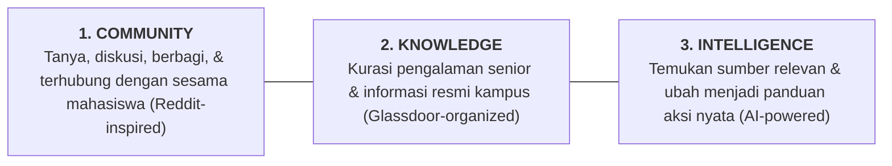
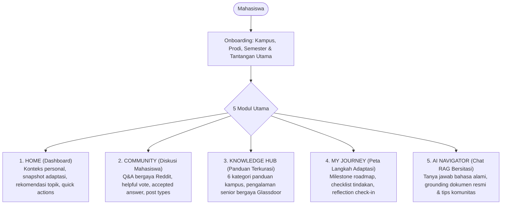

# Campus Compass — Master Product Specification (PRD)

> **Dokumen**: `docs/PRODUCT_SPEC.md`  
> **Status**: Aligned with Official Feature Blueprint (v1.0)  
> **Target Vibe Coding**: Selesai Senin, 23 November 2026  
> **Target Debugging & QA**: Selesai Sabtu, 28 November 2026  
> **Repositori**: `hybrid-campus-platform` (Campus Compass)

---

## 1. Product Positioning & Executive Summary

**Campus Compass** adalah platform adaptasi mahasiswa dan pusat pengetahuan komunitas (*Student Adaptation & Community Knowledge Platform*). 

### Product Positioning
> *"Reddit-inspired community, Glassdoor-organized experiences, and AI-powered guidance — designed to help students navigate academic, social, and campus life."*

### Gagasan Utama
Pengalaman mahasiswa tidak berhenti sebagai cerita atau komentar obrolan yang cepat tenggelam. Pengalaman yang relevan dapat:
1. **Dicari & Difilter** berdasarkan prodi dan semester.
2. **Dikurasi** menjadi basis pengetahuan (*Knowledge Hub*).
3. **Digunakan AI** (*AI Navigator*) sebagai sumber jawaban terpercaya yang bersitasi.
4. **Diterjemahkan Menjadi Langkah Aksi Nyata** (*My Journey*) untuk menyelesaikan masalah adaptasi perkuliahan.

---

## 2. Masalah yang Diselesaikan & Target Pengguna

### Masalah Utama:
- Informasi akademik, administratif, sosial, dan fasilitas tersebar tidak terstruktur di website kampus, media sosial, dokumen PDF tebal, serta grup WhatsApp/Telegram.
- Mahasiswa baru sering tidak tahu sumber yang tepat atau orang yang tepat untuk ditanya.
- Pengalaman berharga dari kakak tingkat mudah hilang di percakapan dan sulit ditemukan kembali.
- Jawaban AI publik generik sering kali halusinasi karena tidak memahami aturan lokal prodi/kampus.
- Mahasiswa membutuhkan bukan hanya jawaban teori, tetapi juga **langkah praktis** untuk adaptasi.

### Target Segmen Pengguna:
1. **Mahasiswa Tahun 1–2 (Pengguna Utama)**: Membutuhkan panduan adaptasi awal, jawaban cepat, dan rasa terhubung.
2. **Mahasiswa Tahun 3+ (Kontributor / Calon Mentor)**: Membagikan pengalaman, tips praktikum, dan membantu junior.
3. **Mahasiswa Pindahan**: Memahami lingkungan kampus, administrasi konversi SKS, dan prosedur baru.
4. **Moderator / Admin Kampus**: Menjaga kualitas data, memverifikasi dokumen resmi, dan mengelola komunitas.

---

## 3. Prinsip Desain Produk

1. **Community-First**: Interaksi mahasiswa menjadi sumber pengetahuan utama yang hidup.
2. **Source-Aware**: Setiap informasi penting menampilkan asal usul, konteks, dan tanggal pembaruan (bukan sekadar rumor).
3. **Action-Oriented**: Rekomendasi mengarah pada tindakan nyata yang bisa diselesaikan mahasiswa, bukan sekadar konsumsi konten pasif.
4. **Campus-Specific**: Hasil pencarian dan rekomendasi terkunci pada kampus dan program studi mahasiswa (multi-tenant isolation).
5. **Privacy-by-Design & UU PDP**: Kepatuhan penuh terhadap **UU No. 27 Tahun 2022 tentang Pelindungan Data Pribadi**. Data pribadi diminimalkan (dilarang meminta NIM atau alamat tanpa alasan jelas).

---

## 4. Arsitektur 5 Area Utama Aplikasi

Aplikasi dirancang sebagai *responsive web app* dengan **5 modul utama**:

---

### Area 1: Home (Personalized Dashboard)
Titik masuk harian mahasiswa yang menjawab pertanyaan: *"Apa yang relevan untuk saya sekarang?"*
- **Welcome Context**: Menampilkan sapaan personal, kampus, prodi, dan semester mahasiswa.
- **Adaptation Snapshot**: Menampilkan milestone atau checklist *My Journey* yang belum selesai.
- **Recommended for You**: Rekomendasi panduan dan diskusi berdasarkan kombinasi prodi, semester, dan tantangan yang dipilih saat onboarding.
- **Trending Discussions & Unanswered Questions**: Menampilkan diskusi yang sedang hangat atau pertanyaan baru yang butuh bantuan jawaban (mengatasi *cold start*).
- **Quick Actions**: Tombol cepat untuk buat pertanyaan, bagikan pengalaman, atau cari panduan.

---

### Area 2: Community (Reddit-Inspired Interaction)
Ruang interaksi antar-mahasiswa untuk saling bertanya dan membantu:
- **Jenis Postingan**:
  - `Question`: Pertanyaan yang membutuhkan jawaban/saran (misal: tips membagi waktu saat praktikum).
  - `Experience`: Mahasiswa berbagi pengalaman personal (misal: pengalaman ikut organisasi di tahun pertama).
  - `Guide`: Panduan langkah demi langkah yang dibuat mahasiswa.
  - `Opportunity`: Informasi lomba, beasiswa, kepanitiaan, atau lowongan magang.
- **Mekanisme Interaksi Kunci**:
  - **Helpful Vote**: Penandaan postingan/jawaban yang bermanfaat (MVP tidak memerlukan downvote).
  - **Accepted Answer**: Penanya dapat menandai 1 jawaban yang paling menyelesaikan masalahnya.
  - **Bookmark & Report**: Menyimpan diskusi penting dan melaporkan spam/konten bermasalah.
  - **Filter Cepat**: Berdasarkan topik, prodi, semester, dan status jawaban (terjawab / belum).

---

### Area 3: Knowledge Hub & Senior Experiences (Glassdoor-Organized)
Menyimpan panduan terkurasi dan pengalaman terstruktur yang tahan lama:
- **Format Pengalaman Terstruktur (Senior Experience Database)**:
  - Form kontribusi praktis mencakup: *Situasi*, *Tantangan yang Dihadapi*, *Solusi yang Dicoba*, *Hasil*, dan *Saran untuk Junior*.
  - Label verifikasi kontributor (*Verified Contributor*).
- **6 Kategori Panduan Knowledge Hub**:
  1. **Academic Survival**: Metode belajar, strategi tugas, praktikum, ujian, dan sistem perkuliahan.
  2. **Social & Community**: Organisasi, UKM, komunitas pertemanan, dan kegiatan mahasiswa.
  3. **Administrative Guide**: Pengisian KRS, layanan akademik fakultas, kontak birokrasi, dan kalender penting.
  4. **Campus Essentials**: Fasilitas penting, perpustakaan, transportasi kampus, kantin, dan ruang belajar.
  5. **Scholarship & Growth**: Info beasiswa, kompetisi, volunteer, dan pengembangan diri.
  6. **Career Preparation**: CV, portofolio, persiapan magang (KP), dan seleksi kerja.

---

### Area 4: My Journey (Personalized Adaptation Journey)
Menerjemahkan kebutuhan mahasiswa menjadi daftar tindakan nyata (*actionable roadmap*):
- **Input Personalisasi**:
  - Semester / Tahun masuk.
  - Area Adaptasi (Akademik, Sosial, Pribadi/Pengelolaan Diri, Fasilitas, Peluang).
  - Tantangan Utama (misal: *Time Management*, Adaptasi Silabus Dosen, Mencari Komunitas).
- **Contoh Tahap & Milestone**:
  - *Understand Campus*: Mengenali layanan administrasi dan fasilitas utama.
  - *Understand Academics*: Memahami sistem KRS, LMS kampus, kalender, dan prasyarat matakuliah.
  - *Build Study Routine*: Membuat jadwal belajar mandiri dan memetakan tenggat tugas praktikum.
  - *Find Community*: Menjelajahi UKM/kelompok belajar dan networking.
  - *Explore Opportunities*: Mengikuti info magang, riset dosen, dan beasiswa.
  - *Reflect and Adjust*: Evaluasi berkala atas apa yang sudah terbantu dan hal yang masih sulit.
- **Status Progres**: *Not Started*, *In Progress*, *Completed*, *Skipped*.

---

### Area 5: AI Campus Navigator (Retrieval-Augmented Guidance)
Asisten cerdas berbasis RAG yang menjawab pertanyaan mahasiswa dengan bahasa sehari-hari:
- **Prinsip AI**: AI bukan chatbot umum dan **dilarang keras mengarang kebijakan kampus**.
- **Sumber Data yang Boleh Digunakan AI**:
  1. *Official Campus Sources*: Prosedur resmi, kalender, dokumen kurikulum prodi.
  2. *Curated Guides*: Panduan terkurasi dari Knowledge Hub.
  3. *Verified Community Experiences*: Pengalaman senior dan jawaban komunitas yang diizinkan untuk retrieval.
- **Source Cards & Citations**: Setiap jawaban wajib menampilkan pil sumber rujukan lengkap dengan judul dokumen dan tautannya.
- **Insufficient Evidence Handling**: Jika bukti dalam basis data tidak memadai, AI secara jujur menyatakan ketidaktahuannya dan mengarahkan pengguna membuat pertanyaan di forum Community atau menghubungi kontak resmi kampus.

---

## 5. Batasan Ruang Lingkup MVP (P0 vs P1 vs P2)

| Prioritas | Fitur / Komponen | Kriteria Selesai (Target 23 Nov 2026) |
| :--- | :--- | :--- |
| **P0 (Wajib MVP)** | Autentikasi Supabase, Profil & Onboarding tantangan, Home Dashboard personal, Community feed & create post/comment, Helpful vote, Knowledge Hub dasar, Report dasar. | Mahasiswa dapat mendaftar, memilih prodi/tantangan, bertanya, menjawab, dan membaca panduan terkurasi. |
| **P1 (Pembeda Utama)** | **AI Navigator** dengan RAG bersitasi sumber, **My Journey** adaptation checklist rule-based, rekomendasi dashboard otomatis. | AI menjawab dengan sumber valid dan My Journey memberikan langkah adaptasi konkret. |
| **P2 (Ekspansi Masa Depan)** | *Peer matching* lanjut, *private messaging* langsung, peta interaktif gedung kampus (*interactive campus map*), analitik dashboard prodi multi-kampus. | Ditunda untuk fase berikutnya agar tidak menambah beban moderasi dan privasi di MVP. |

---

## 6. Skenario Demo Hackathon (6 Adegan Utama)

Skenario alur presentasi yang disiapkan untuk demo aplikasi:

| No | Adegan Demo | Yang Diperlihatkan | Nilai Produk yang Dibuktikan |
| :---: | :--- | :--- | :--- |
| **1** | **Onboarding** | Mahasiswa baru login, memilih kampus pilot, prodi pilot, semester 1, dan memilih tantangan *Time Management*. | Produk langsung memahami konteks dan kebutuhan personal pengguna. |
| **2** | **Home** | Dashboard menampilkan sapaan personal, kartu snapshot adaptasi, serta rekomendasi panduan sesuai tantangan. | Personalisasi berjalan instan tanpa *cold-start*. |
| **3** | **Community** | Pengguna membuat pertanyaan tentang praktikum; mahasiswa lain memberikan jawaban berformat; penanya memberi *helpful vote*. | Interaksi *peer-to-peer* yang saling membantu berjalan nyata. |
| **4** | **Knowledge Hub** | Menjelajahi panduan terkurasi 6 kategori dan membaca pengalaman senior berformat (situasi $\rightarrow$ tantangan $\rightarrow$ solusi). | Pengetahuan berharga tersimpan rapi dan tidak tenggelam di feed. |
| **5** | **AI Navigator** | Mahasiswa bertanya: *"Apa prasyarat lab fisika dasar?"*; AI menjawab cepat lengkap dengan *source card* dokumen resmi. | RAG terintegrasi dan faktual, bukan chatbot generik halusinasi. |
| **6** | **My Journey** | Mahasiswa membuka peta adaptasi semester 1 dan menandai checklist selesai (*completed*). | Informasi diterjemahkan menjadi tindakan nyata mahasiswa. |

---

## 7. North Star Metric & Keberhasilan Produk

> **NORTH STAR METRIC**: **Successful Student Help Sessions**  
> *(Jumlah sesi interaksi ketika mahasiswa benar-benar menemukan panduan, jawaban, atau langkah tindakan yang dinilai membantu adaptasi mereka).*

Fokus keberhasilan bukan sekadar jumlah akun atau *page views*, melainkan seberapa efektif mahasiswa terbantu mengatasi kebingungan perkuliahan mereka.
