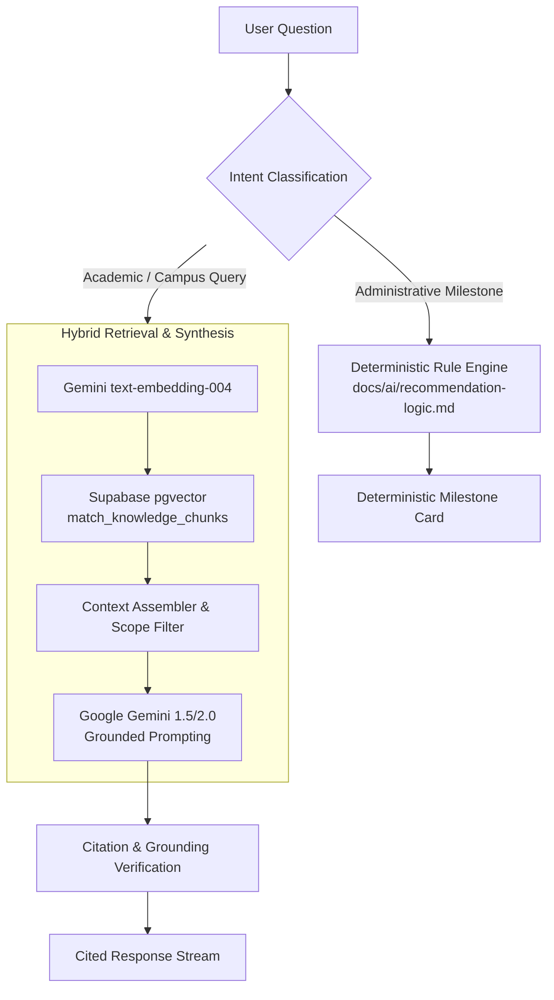

# AI Subsystem Architecture & Safety Guardrails

> **Document**: `docs/ai/ai-architecture.md`  
> **Owner**: Erick & Netta  
> **Status**: Approved (Foundation Phase)  
> **Last Updated**: 2026-11-20  
> **Dependencies**: [`docs/ai/rag-retrieval-flow.md`](rag-retrieval-flow.md), [`docs/ai/gemini-integration.md`](gemini-integration.md), [`docs/ai/recommendation-logic.md`](recommendation-logic.md)

---

## 1. Purpose

This document articulates the design of the AI intelligence layer for Campus Compass. It establishes how hybrid knowledge retrieval, large language models, and deterministic rules collaborate to deliver accurate, tenant-isolated, and hallucination-free student guidance.

---

## 2. AI Subsystem Architecture

---

## 3. Core AI Principles & Guardrails

### 1. Zero Hallucination Policy for Academic Rules
- Academic prerequisites, graduation credits, and official university policies cannot be "guessed" or hallucinated.
- If the semantic similarity score of retrieved chunks fails to meet the confidence threshold ($\ge 0.65$), the model must explicitly declare: *"We could not locate verified department policy on this matter."*

### 2. Dual-Layer Context Blending
The retrieval engine explicitly blends two knowledge scopes:
- **Scope A (General)**: Universal academic skills (e.g., how to format IEEE citations, time management tips).
- **Scope B (Campus-Scoped)**: Local department regulations (e.g., prerequisite courses for CS-301 in the pilot program).

### 3. Separation of Generative AI and Critical Milestones
Generative models are used for **explanation, synthesis, and search**. Critical deadlines, graduation prerequisites, and lab safety clearances are managed by **deterministic rule logic** (`docs/ai/recommendation-logic.md`).

---

## 4. Confirmed vs. Proposed AI Architecture

### Confirmed
- [x] RAG architecture with Google Gemini API and Supabase pgvector.
- [x] Dual-layer context retrieval with metadata tenant filtering.
- [x] Deterministic rule engine for semester milestones.
- [x] Mandatory citation pills on all generated responses.

### Proposed
- [ ] Query re-writing/expansion step to improve retrieval for short student queries (e.g. "KRS deadline"). (Owner: Erick)
- [ ] Semantic caching of common query embeddings using Redis. (Deferred to Phase 2)

---

## 5. Open Questions

1. Should the LLM generate proactive follow-up question suggestions at the end of each answer? (Owner: Erick / Rifal)
