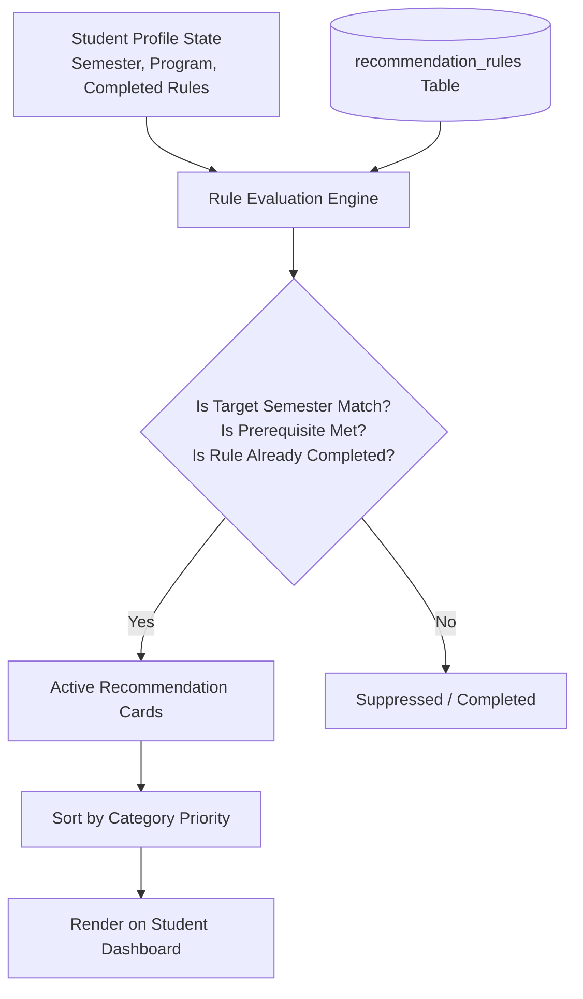
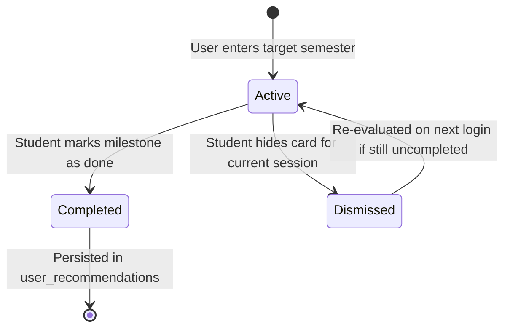

# Rule-Based Recommendation Logic

> **Document**: `docs/ai/recommendation-logic.md`  
> **Owner**: Netta (Backend, Database & AI Architecture Lead)  
> **Status**: Approved (Foundation Phase)  
> **Last Updated**: 2026-11-20  
> **Dependencies**: [`docs/database/database-schema.md`](../database/database-schema.md), [`docs/product/product-requirements.md`](../product/product-requirements.md)

---

## 1. Purpose

This document specifies the deterministic, rule-based recommendation engine for Campus Compass. Critical academic milestones—such as prerequisite validations, registration deadlines, and lab clearances—are driven by deterministic business rules rather than probabilistic LLM generations.

---

## 2. Rule Evaluation Engine Architecture



---

## 3. Seed Rule Specifications (Pilot Study Program)

The following deterministic rules serve as the initial rule catalog for the pilot study program:

| Rule Code | Target Semester | Category | Title | Trigger Condition | Action Link | Priority |
| :--- | :---: | :--- | :--- | :--- | :--- | :---: |
| `RULE_SEM1_LAB_INDUCTION` | 1 | `compliance` | Mandatory Digital Lab Safety Induction | `semester = 1 AND status != 'completed'` | `/app/knowledge/lab-safety-induction` | High (1) |
| `RULE_SEM1_ADVISOR_MEET` | 1 | `academic` | Initial Academic Advisor (Dosen PA) Consultation | `semester = 1 AND status != 'completed'` | `/app/knowledge/advisor-protocol` | High (2) |
| `RULE_SEM2_PREREQ_CHECK` | 2 | `academic` | Foundation Prerequisite Check for Year 2 | `semester = 2 AND status != 'completed'` | `/app/knowledge/prereq-tree-year2` | Medium (3) |
| `RULE_SEM3_TRACK_EXPLORATION` | 3 | `career` | Study Track & Specialization Overview | `semester = 3 AND status != 'completed'` | `/app/knowledge/specialization-tracks` | Medium (4) |
| `RULE_SEM5_INTERNSHIP_PREP` | 5 | `career` | Mandatory Internship (Magang / KP) Briefing | `semester = 5 AND status != 'completed'` | `/app/knowledge/internship-guidelines` | High (1) |
| `RULE_SEM7_THESIS_PROPOSAL` | 7 | `graduation` | Final Thesis (Skripsi) Topic Submission Window | `semester = 7 AND status != 'completed'` | `/app/knowledge/thesis-milestones` | Urgent (1) |

---

## 4. Rule State Machine & Lifecycle

Each student's interaction with a recommendation rule follows a strict lifecycle:



---

## 5. Evaluation Query (PostgreSQL / Edge Service)

The active recommendation cards for an authenticated student are retrieved via the following query logic:

```sql
SELECT 
    r.id,
    r.rule_code,
    r.title,
    r.description,
    r.category,
    r.target_semester,
    r.action_url,
    COALESCE(ur.status, 'active') AS user_status
FROM public.recommendation_rules r
LEFT JOIN public.user_recommendations ur 
    ON ur.rule_id = r.id AND ur.profile_id = auth.uid()
WHERE r.is_active = true
  AND r.target_semester = (SELECT semester FROM public.profiles WHERE id = auth.uid())
  AND (r.study_program_id = (SELECT study_program_id FROM public.profiles WHERE id = auth.uid()) OR r.study_program_id IS NULL)
  AND (ur.status IS NULL OR ur.status = 'active')
ORDER BY r.target_semester ASC;
```

---

## 6. Confirmed vs. Proposed Engine Rules

### Confirmed
- [x] Deterministic rule execution separates critical academic guidance from probabilistic LLMs.
- [x] Student semester standing serves as the primary evaluation filter.
- [x] Persistent state tracking (`user_recommendations`) records completions.

### Proposed
- [ ] Due date warning banners when academic registration windows approach. (Owner: Netta / Kalya)

---

## 7. Open Questions

1. What are the exact academic calendar dates for the pilot study program's semester registration milestones? (Owner: Netta / Rifal)
