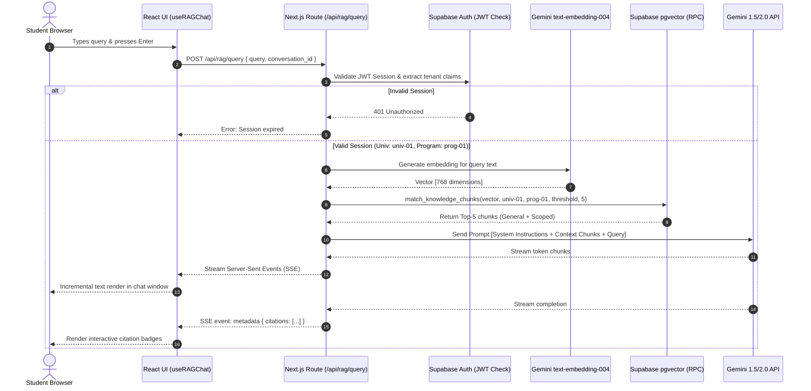
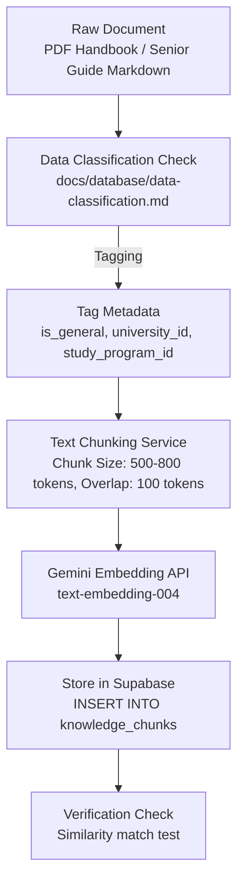

# Integration Flow & Data Lifecycle

> **Document**: `docs/architecture/integration-flow.md`  
> **Owner**: Erick (Technical Setup & AI Dev Lead)  
> **Status**: Approved (Foundation Phase)  
> **Last Updated**: 2026-11-20  
> **Dependencies**: [`docs/architecture/system-architecture.md`](system-architecture.md), [`docs/architecture/api-contract.md`](api-contract.md), [`docs/ai/rag-retrieval-flow.md`](../ai/rag-retrieval-flow.md)

---

## 1. Purpose

This document specifies the end-to-end integration flows across the client application, Next.js server runtime, Supabase managed services, and Google Gemini API. It ensures all asynchronous and stateful operations are handled consistently.

---

## 2. End-to-End RAG Query Lifecycle

The following sequence details how a student question is transformed into a verified, cited answer:

---

## 3. Document Ingestion & Chunking Flow

The ingestion pipeline converts unstructured academic documentation into searchable vector embeddings:

---

## 4. Failure Modes & Graceful Degradation

| Failure Scenario | System Behavior | User Experience |
| :--- | :--- | :--- |
| **Gemini API Outage / Rate Limit** | Route catches 429/500 error; falls back to raw vector keyword match snippets. | Banner: "AI synthesis is temporarily unavailable. Showing direct handbook excerpts." |
| **No Relevant Chunks Found (Score < 0.60)** | RAG pipeline skips generative hallucination. | Friendly message: "We couldn't find verified guidance for this in our pilot database. Would you like to submit this question to senior mentors?" |
| **Database Connection Latency (> 3.0s)** | AbortController cancels pending vector query. | Prompt retry button: "Request timed out while checking campus records. Please retry." |

---

## 5. Confirmed vs. Proposed Flows

### Confirmed
- [x] All Gemini API interactions are proxied through server-side Next.js route handlers.
- [x] Streamed responses use standard Web Streams API / Server-Sent Events.
- [x] Explicit fallback when semantic similarity falls below threshold.

### Proposed
- [ ] Optimistic client-side caching of recent chat sessions in browser IndexedDB (Owner: Kalya).

---

## 6. Open Questions

1. Should document ingestion be exposed via an administrative UI in MVP, or executed via manual database scripts? (Owner: Erick / Netta)
2. What retry strategy (exponential backoff vs immediate retry) will be configured for Gemini API transient errors? (Owner: Erick)
