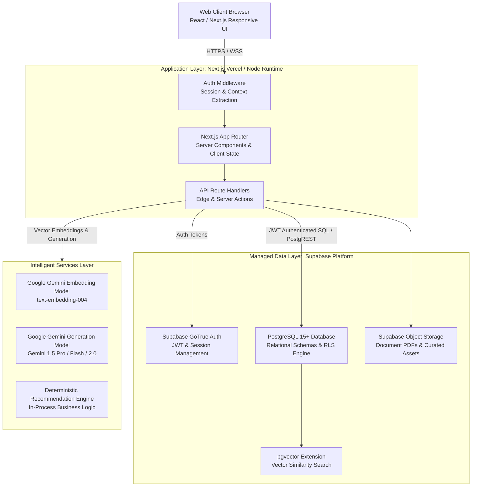

# System Architecture Overview

> **Document**: `docs/architecture/system-architecture.md`  
> **Owner**: Erick & Netta  
> **Status**: Approved (Foundation Phase)  
> **Last Updated**: 2026-11-20  
> **Dependencies**: [`docs/architecture/tech-stack.md`](tech-stack.md), [`docs/database/database-schema.md`](../database/database-schema.md), [`docs/ai/ai-architecture.md`](../ai/ai-architecture.md)

---

## 1. Purpose

This document describes the high-level system architecture, component topology, network boundaries, and security perimeters of Campus Compass. It serves as the primary technical blueprint for engineering implementations.

---

## 2. High-Level Architecture Topology

Campus Compass is architected as a modern, decoupled web application utilizing serverless backend primitives and managed AI services:



---

## 3. Subsystem Breakdown

### 1. Presentation & Application Layer (Next.js)
- **Role**: Delivers server-rendered initial pages, handles client-side transitions, executes Server Actions, and proxies secure API calls.
- **Security Boundary**: The client browser never receives service-role keys or direct LLM secret tokens. All AI orchestration and privileged database operations occur inside server-side route handlers.

### 2. Managed Backend & Data Layer (Supabase)
- **PostgreSQL Database**: Serves as the relational single source of truth for users, universities, study programs, knowledge articles, and senior tips.
- **Row Level Security (RLS)**: Enforces access rules at the database engine level, guaranteeing that campus-scoped data cannot be leaked to unauthorized users even if an application route has a logic defect.
- **pgvector**: Stores high-dimensional vector embeddings of knowledge documents alongside their relational foreign keys (`university_id`, `study_program_id`, `is_general`).

### 3. AI & Intelligent Services Layer
- **Embedding Pipeline**: Converts official handbooks, curated notes, and user queries into dense vector representations.
- **Google Gemini API**: Synthesizes verified retrieved context into student-friendly, actionable responses complete with explicit citations.
- **Deterministic Rule Engine**: Evaluates student profile attributes (e.g., semester standing, major) against hardcoded academic milestones to ensure 100% predictable guidance for critical tasks.

---

## 4. Multi-Tenant Scoping Architecture

To support future expansion while maintaining a lean MVP:
- **Tenant Scope Key**: Every campus-specific entity contains `university_id` and optionally `study_program_id`.
- **Hybrid Filter**: RAG queries execute an SQL filter:
  ```sql
  WHERE is_general = true 
     OR (university_id = $auth_university_id AND (study_program_id = $auth_program_id OR study_program_id IS NULL))
  ```
This ensures zero cross-institution data bleed while allowing general college tips to be universally accessible.

---

## 5. Security & Boundary Guarantees

1. **Defense-in-Depth**: Security is enforced at three distinct layers:
   - Next.js Edge Middleware (Validates session existence).
   - Server Route Handlers (Validates payload structure and parameters).
   - PostgreSQL RLS (Validates data ownership and tenant scope).
2. **Environment Variable Segregation**:
   - `NEXT_PUBLIC_*`: Restricted to public Supabase URL and anon key.
   - Server-only secrets: `SUPABASE_SERVICE_ROLE_KEY`, `GEMINI_API_KEY`.
3. **Auditability**: All AI prompts and retrieved chunk IDs are logged with session identifiers for quality assurance and hallucination audits.

---

## 6. Confirmed vs. Proposed Architecture

### Confirmed
- [x] Next.js App Router for frontend and API routes.
- [x] Supabase (PostgreSQL + RLS + pgvector) for data storage and retrieval.
- [x] Google Gemini API for embeddings and grounded synthesis.

### Proposed
- [ ] Redis / Upstash caching layer for frequent RAG query embeddings (deferred to Phase 2).
- [ ] Background worker queues for async document chunking (in-memory server actions sufficient for MVP).

---

## 7. Open Questions

1. Will the production Supabase instance be hosted on Supabase Cloud or self-hosted via Docker? (Owner: Netta / Erick)
2. What rate-limiting policy will be applied to the `/api/rag/query` endpoint to protect Gemini API quotas? (Owner: Erick)
