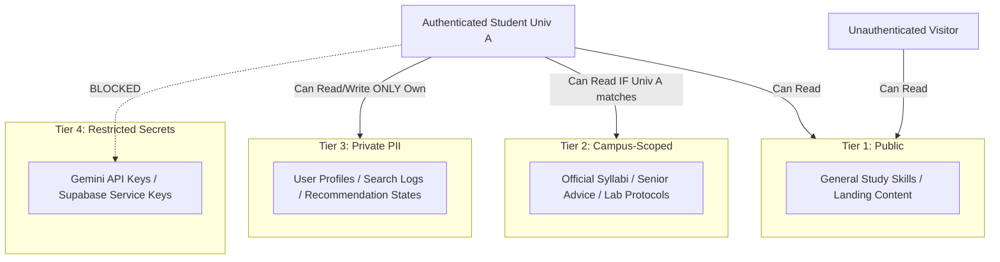

# Data Classification & Privacy Matrix

> **Document**: `docs/database/data-classification.md`  
> **Owner**: Netta (Backend, Database & AI Architecture Lead)  
> **Status**: Approved (Foundation Phase)  
> **Last Updated**: 2026-11-20  
> **Dependencies**: [`docs/database/rls-policies.md`](rls-policies.md), [`docs/database/database-schema.md`](database-schema.md)

---

## 1. Purpose

This document establishes the data classification taxonomy, access boundaries, retention requirements, and privacy compliance rules for Campus Compass. It ensures strict protection of student Personally Identifiable Information (PII) and campus-scoped academic assets.

---

## 2. Data Classification Tiers

| Tier | Classification | Sensitivity | Description | Examples | Access Controls |
| :--- | :--- | :--- | :--- | :--- | :--- |
| **Tier 1** | **Public** | Low | Information intended for broad external consumption; no competitive or privacy risk. | University names, program list, general study skills, marketing pages. | Public read; admin write; CDN cacheable. |
| **Tier 2** | **Campus-Scoped** | Medium | Academic regulations, syllabi insights, and department tips restricted to a specific institution. | Lab schedules, grading policies, prerequisite maps, senior survival guides. | Authenticated students of that specific university/program only. |
| **Tier 3** | **Private Student Data (PII)** | High | Personally Identifiable Information and individual student activity records. | Student email, full name, semester progress, query history, completed checklists. | Owning student only (`auth.uid() = profile_id`); encrypted at rest. |
| **Tier 4** | **Restricted / Secrets** | Critical | Infrastructure secrets, API keys, service role credentials, encryption keys. | `SUPABASE_SERVICE_ROLE_KEY`, `GEMINI_API_KEY`, database connection strings. | Server-side runtime only; zero client exposure; rotated quarterly. |

---

## 3. Data Flow & Boundary Enforcement

---

## 4. Privacy & Regulatory Compliance

### Indonesian PDP Law (UU Pelindungan Data Pribadi) & GDPR Alignment
1. **Purpose Limitation**: Student data is collected solely to personalize academic recommendations and retrieve relevant campus information. It will never be sold or shared with external advertising networks.
2. **Right to Erasure (Data Deletion)**: If a student deletes their account, cascading foreign keys (`ON DELETE CASCADE`) delete all associated profile data, recommendation tracking, and private query logs.
3. **Data Anonymization**: Senior student interview quotes and contributed tips may be published under an anonymous banner upon the contributor's request, decoupling qualitative advice from personal identity.

---

## 5. Confirmed vs. Proposed Classifications

### Confirmed
- [x] Tiered 4-level taxonomy (Public, Campus-Scoped, Private, Restricted).
- [x] Strict tenant isolation for Tier 2 using Supabase RLS.
- [x] Zero client-side storage for Tier 4 secrets.

### Proposed
- [ ] Auto-purge policy for raw student query logs after 90 days (Owner: Netta).

---

## 6. Open Questions

1. Does the pilot university require student data to be hosted exclusively on data centers physically located in Indonesia? (Owner: Netta / Erick)
