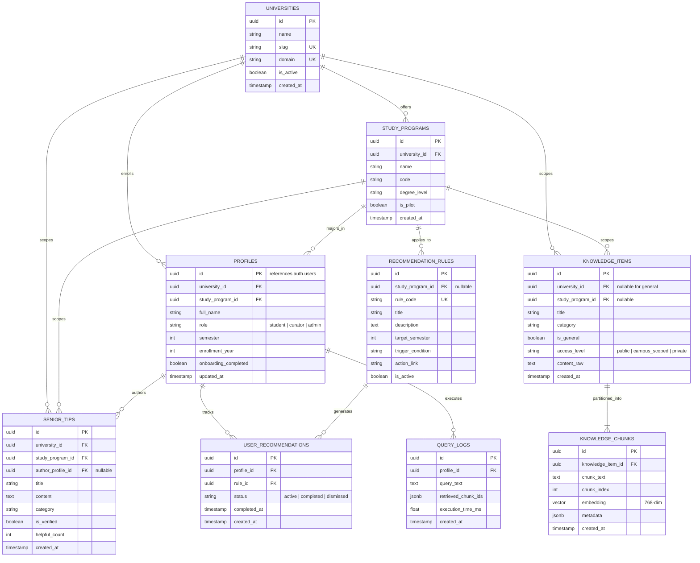

# Entity-Relationship Diagram (ERD)

> **Document**: `docs/database/erd.md`  
> **Owner**: Netta (Backend, Database & AI Architecture Lead)  
> **Status**: Approved (Foundation Phase)  
> **Last Updated**: 2026-11-20  
> **Dependencies**: [`docs/database/database-schema.md`](database-schema.md), [`docs/database/data-classification.md`](data-classification.md)

---

## 1. Purpose

This document visualizes the relational data model for Campus Compass. It captures all entity types, attributes, primary/foreign keys, and relational cardinalities supporting tenant-scoped knowledge retrieval and user progress tracking.

---

## 2. Visual Entity-Relationship Diagram

---

## 3. Relational Cardinality Summary

1. **Universities & Programs**:
   - One `university` has many `study_programs` (1:N).
   - In MVP, exactly 1 `university` record and 1 `study_program` record are marked as active pilots.
2. **Profiles & Authentication**:
   - `profiles.id` mirrors Supabase `auth.users.id` (1:1).
   - A `profile` belongs to one `university` and one `study_program` (N:1).
3. **Knowledge Items & Vector Chunks**:
   - A `knowledge_item` has many `knowledge_chunks` (1:N).
   - If `knowledge_items.is_general = TRUE`, then `university_id` and `study_program_id` are NULL.
   - If `is_general = FALSE`, `university_id` is mandatory.
4. **Recommendation Engine**:
   - A `recommendation_rule` generates `user_recommendations` state for students based on their profile semester standing.

---

## 4. Confirmed vs. Proposed Relationships

### Confirmed
- [x] Multi-tenant ready entity structure with foreign key scoping.
- [x] Separation between high-level knowledge items and vector search chunks.
- [x] 1:1 binding between Supabase `auth.users` and application `profiles`.

### Proposed
- [ ] Direct student bookmark / favorite entity for knowledge articles (`profile_bookmarks`).
- [ ] Dedicated audit log table for admin moderation actions.

---

## 5. Open Questions

1. Should senior tips author profiles allow anonymous display while retaining the internal `author_profile_id` reference? (Owner: Netta / Rifal)
