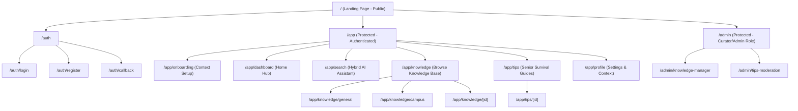

# Sitemap & Information Architecture

> **Document**: `docs/product/sitemap.md`  
> **Owner**: Kalya (Frontend & UX Lead)  
> **Status**: Draft (In Progress)  
> **Last Updated**: 2026-11-20  
> **Dependencies**: [`docs/product/product-requirements.md`](product-requirements.md), [`docs/product/user-flow.md`](user-flow.md), [`docs/architecture/folder-structure.md`](../architecture/folder-structure.md)

---

## 1. Purpose

This document defines the web application's page hierarchy, URL routing structure, and route access levels for Campus Compass. It guides Kalya in implementing Next.js App Router routes and provides a blueprint for frontend navigation.

---

## 2. Route Hierarchy & Access Matrix

---

## 3. Detailed Route Specifications

### Public Routes
| Route | Access Level | Description |
| :--- | :--- | :--- |
| `/` | Public | Marketing landing page detailing Campus Compass, pilot scope, and login CTA. |
| `/auth/login` | Public (Unauthenticated) | Email/password sign-in form. |
| `/auth/register` | Public (Unauthenticated) | Account registration form. |
| `/auth/callback` | Public | OAuth / magic-link callback handler route. |

### Protected Application Routes (`/app`)
*Requires active Supabase session. Redirects to `/auth/login` if unauthenticated.*

| Route | Access Level | Description |
| :--- | :--- | :--- |
| `/app/onboarding` | Authenticated (New User) | Initial profile setup: Select pilot university, pilot study program, and semester. |
| `/app/dashboard` | Authenticated | Main student hub: Semester recommendation cards, quick search bar, recent tips. |
| `/app/search` | Authenticated | Conversational AI RAG interface with streaming responses and cited source cards. |
| `/app/knowledge` | Authenticated | Dual-layer knowledge repository index with category filters. |
| `/app/knowledge/general` | Authenticated | General cross-campus guides (study skills, academic integrity, wellness). |
| `/app/knowledge/campus` | Authenticated (Scoped) | Pilot university & program-specific policies, prerequisites, and facility guides. |
| `/app/knowledge/[id]` | Authenticated | Detailed view of a single knowledge document with markdown rendering. |
| `/app/tips` | Authenticated | Curated senior student tips, sorted by academic tags and popularity. |
| `/app/tips/[id]` | Authenticated | Full senior insight article with author attribution and related topics. |
| `/app/profile` | Authenticated | View and update user profile, academic standing, and notification settings. |

### Protected Curator / Admin Routes (`/admin`)
*Requires authenticated session with `role = 'admin'` or `role = 'curator'`.*

| Route | Access Level | Description |
| :--- | :--- | :--- |
| `/admin/knowledge-manager` | Curator / Admin | Interface to add, edit, or archive knowledge articles and verify embeddings. |
| `/admin/tips-moderation` | Curator / Admin | Review submitted senior tips and toggle publish status. |

---

## 4. Confirmed vs. Proposed Decisions

### Confirmed Decisions
- [x] Application adopts Next.js App Router conventions with grouped route segments (`(auth)`, `(dashboard)`).
- [x] Mandatory onboarding step locks student context to the pilot university and program.
- [x] Clear separation between Public, Student Protected, and Admin routes.

### Proposed Decisions (Pending Kalya & Rifal Confirmation)
- [ ] Implement a unified search drawer/modal accessible globally via keyboard shortcut (`Cmd+K` / `Ctrl+K`).
- [ ] Add an offline caching route for saved guides using progressive web app (PWA) service workers.

---

## 5. Open Questions

1. Should the `/admin` interface be included in the initial MVP frontend, or should early knowledge seeding be performed via Supabase Studio scripts? (Owner: Kalya / Netta)
2. What fallback screen should be presented if a student from an unsupported university attempts to sign up? (Owner: Kalya / Rifal)
