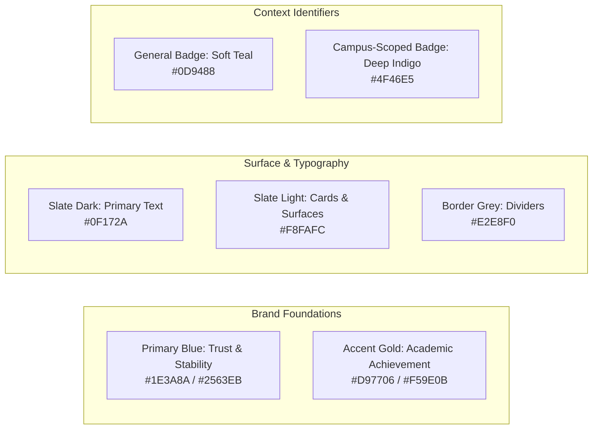

# UI/UX Design Guidelines & Moodboard Direction

> **Document**: `docs/product/ui-ux-guidelines.md`  
> **Owner**: Rifal (Product & UI/UX Direction Lead)  
> **Status**: Draft (In Progress)  
> **Last Updated**: 2026-11-20  
> **Dependencies**: [`docs/00-project-overview.md`](../00-project-overview.md), [`assets/moodboard/`](../../assets/moodboard/)

---

## 1. Purpose

This document provides the visual direction, design tokens, typography rules, component patterns, and moodboard inspiration for Campus Compass. It governs how Kalya and frontend engineers implement visual elements.

---

## 2. Visual Style & Moodboard Philosophy

Campus Compass must evoke **clarity, academic credibility, modern warmth, and effortless navigation**. It avoids the cluttered, bureaucratic aesthetic of traditional university portals while steering clear of overly playful, distractingly casual designs.

### Core Visual Tenets
- **Academic Precision with Modern Warmth**: Professional, trustworthy, and calm. The UI should lower cognitive anxiety for stressed students.
- **Content-First Simplicity**: Clean typography, generous whitespace, and prominent citations.
- **Context Awareness**: Clear visual badges to instantly differentiate **General Advice** from **Campus-Specific Policy**.

---

## 3. Design Tokens (Proposed Framework)

> [!NOTE]
> Specific hexadecimal tokens and font pairings below are initial proposals curated by Rifal. Final tokens will be confirmed following moodboard review.

### Color Palette (Proposed)

### Typography Hierarchy (Proposed)
- **Primary Display & Headings**: Inter or Plus Jakarta Sans (Clean, modern sans-serif with excellent legibility at variable weights).
- **Body & Academic Content**: Inter or System UI stack (Optimized for prolonged reading and screen rendering).
- **Code & Course Codes**: JetBrains Mono or Fira Code (For course identifiers like `CS-201`, `MATH-102`).

---

## 4. Component Patterns & Guidelines

### A. Context Scoping Badge
Every card, knowledge snippet, and search citation must visually declare its scope:
- **General Knowledge**: `[🌐 General Academic]` — Muted teal background with border.
- **Campus-Scoped**: `[🏛️ Pilot University • Program Name]` — Prominent indigo background to signal official department grounding.

### B. Citation Pill Component
When the AI assistant provides an answer, citations must render as clickable interactive pills:
- Format: `[1] Dept Handbook §4.2` or `[2] Senior Interview #3`.
- Hover state: Previews snippet text and author/source authority.
- Click state: Opens the full source document in a contextual side-drawer.

### C. Recommendation Cards
- Elevated card with subtle border and status indicator.
- Action items clearly demarcated with checkbox or completion button.

---

## 5. Assets & Visual References Directory Structure

Visual inspiration, Figma exports, and competitor benchmarks are organized as follows:
- `assets/moodboard/`: Color palette swatches, typography specimens, moodboard boards.
- `assets/references/`: Screenshots of benchmark platforms, card patterns, and dashboard layouts.
- `assets/diagrams/`: High-resolution architectural and flow diagrams.

---

## 6. Confirmed vs. Proposed Design Decisions

### Confirmed Decisions
- [x] Clean, modern, distraction-free aesthetic with high contrast for accessibility.
- [x] Clear visual distinction between General and Campus-Scoped knowledge items.
- [x] Citation pills are mandatory on all AI-generated content.

### Proposed Decisions (Pending Rifal's Final Sign-off)
- [ ] Final primary brand color choice: Deep Collegiate Navy vs. Modern Royal Slate.
- [ ] Dark mode support in initial MVP release vs. deferring to Phase 2.
- [ ] Illustration style: Minimalist vector iconography vs. custom character illustrations.

---

## 7. Open Questions

1. Will the pilot university’s official brand colors be subtly reflected in the campus-scoped UI elements, or will Campus Compass use a strictly neutral, independent brand identity? (Owner: Rifal)
2. What icon library will be adopted as standard (e.g., Lucide React, Phosphor Icons, or Radix UI Icons)? (Owner: Rifal / Kalya)
