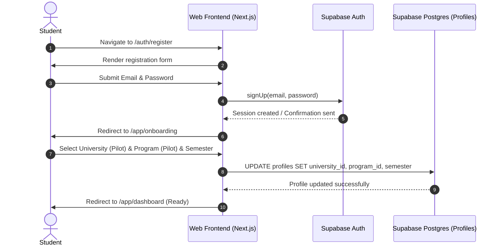
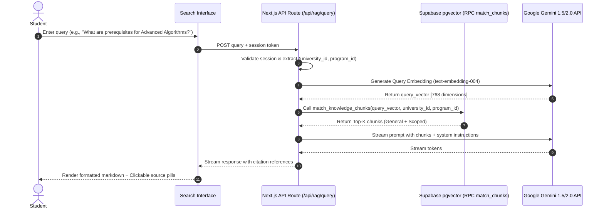
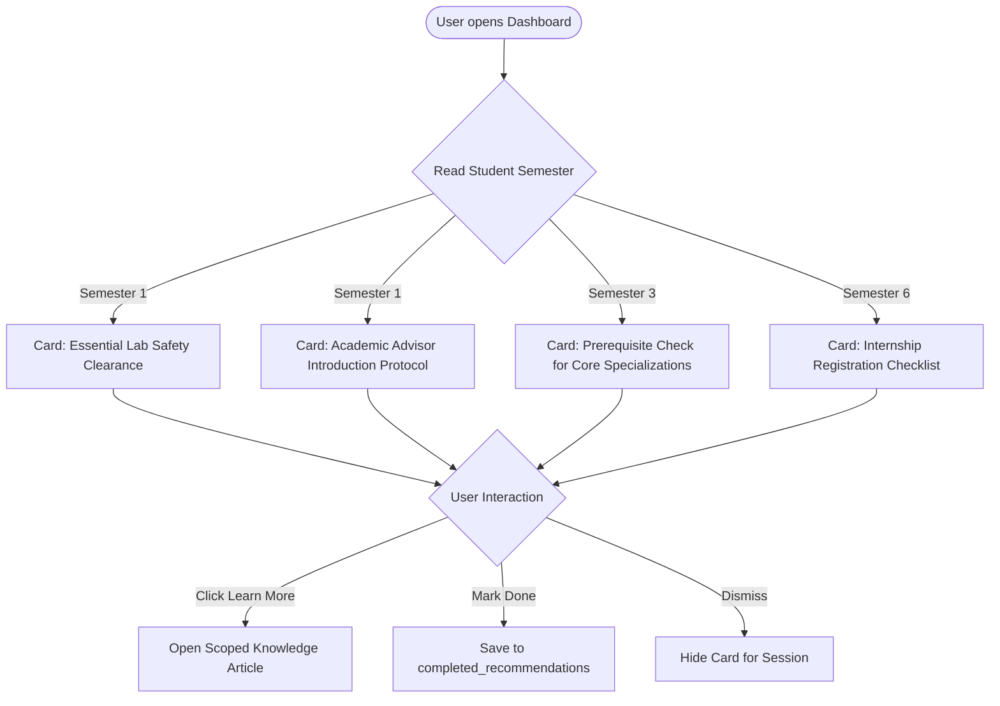

# User Flow & Journey Maps

> **Document**: `docs/product/user-flow.md`  
> **Owner**: Kalya (Frontend & UX Lead)  
> **Status**: Draft (In Progress)  
> **Last Updated**: 2026-11-20  
> **Dependencies**: [`docs/product/sitemap.md`](sitemap.md), [`docs/product/product-requirements.md`](product-requirements.md)

---

## 1. Purpose

This document details the core user journeys through Campus Compass, mapping touchpoints, system validations, and edge cases. It guides Kalya in state management and component interaction design.

---

## 2. Journey 1: Student Onboarding & Context Locking

This flow ensures every student is properly associated with the pilot university and study program before accessing scoped knowledge.

### Edge Cases
- **User abandons onboarding**: If the user leaves `/app/onboarding` and returns later, Next.js middleware detects `profile.onboarding_completed == false` and redirects back to `/app/onboarding`.
- **User selects non-pilot university**: UI locks non-pilot institutions with a "Coming Soon to Your Campus" notification and email waitlist capture.

---

## 3. Journey 2: Dual-Layer RAG Knowledge Search

This journey represents the primary interaction loop: asking questions and receiving grounded, cited answers.

---

## 4. Journey 3: Exploring Rule-Based Recommendations

Students review curated milestones tailored to their academic standing.

---

## 5. Confirmed vs. Proposed Flows

### Confirmed
- [x] Context onboarding is mandatory before accessing `/app/dashboard`.
- [x] AI search streaming flow includes real-time citation pills.
- [x] Student recommendation cards are semester-driven.

### Proposed
- [ ] Save-for-later workflow for senior tips.
- [ ] In-line student feedback widget ("Was this answer accurate for your department?").

---

## 6. Open Questions

1. Should the student be allowed to change their study program after onboarding without contacting an administrator? (Owner: Kalya / Netta)
2. How should the UI handle zero-result RAG queries when no relevant chunks are found? (Owner: Kalya / Erick)
