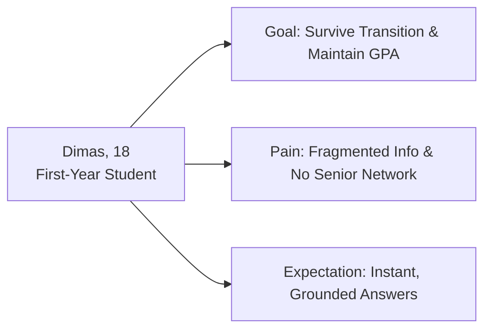

# User Personas

> **Document**: `docs/product/user-personas.md`  
> **Owner**: Rifal & Kalya  
> **Status**: Approved (Foundation Phase)  
> **Last Updated**: 2026-11-20  
> **Dependencies**: [`docs/00-project-overview.md`](../00-project-overview.md), [`docs/03-user-research.md`](../03-user-research.md)

---

## 1. Purpose

This document details the primary and secondary user personas for the Campus Compass pilot. Personas anchor UX design decisions, feature prioritization, and AI prompt engineering to real user needs.

---

## 2. Persona 1: The Overwhelmed Freshman (Primary User)

- **Name**: Dimas Pratama
- **Age**: 18
- **Role**: First-Year Undergraduate Student (Semester 1–2)
- **Background**:
  - Relocated from a different city to attend the pilot university.
  - First in his family to attend higher education; lacks existing alumni or senior networks.
- **Goals**:
  - Understand course prerequisite trees and avoid failing critical foundation courses.
  - Figure out academic bureaucracy (KRS submission, lab safety clearances, library access).
  - Find authentic survival advice on study strategies and faculty expectations.
- **Frustrations**:
  - Department handbook is a 180-page static PDF that is difficult to search.
  - Senior advice in WhatsApp groups gets buried within hours.
  - Public AI chatbots give generic American-college advice that contradicts his university’s local regulations.
- **Tech Behavior**:
  - Mobile-first browser user; expects clean search, quick cards, and zero friction.

---

## 3. Persona 2: The Senior Mentor / Contributor (Secondary User)

- **Name**: Sarah Amanda
- **Age**: 21
- **Role**: Fourth-Year Student (Semester 7–8) / Laboratory Assistant
- **Background**:
  - High academic achiever with active leadership experience in the student association.
  - Frequently approached by juniors asking the same 10 repetitive questions every semester.
- **Goals**:
  - Share hard-won survival tips, exam preparation notes, and internship roadmaps.
  - Reduce repetitive mentoring by publishing structured, authoritative advice once.
  - Contribute to a trusted campus community repository.
- **Frustrations**:
  - Spending hours answering repetitive direct messages on Instagram and WhatsApp.
  - Seeing junior peers fail courses simply because they misunderstood unwritten submission formats.
- **Tech Behavior**:
  - Desktop-oriented power user; values clear attribution and structured markdown curation.

---

## 4. Persona 3: Academic Department Curator / Admin (Administrative User)

- **Name**: Dr. Hendra Wijaya
- **Age**: 42
- **Role**: Study Program Academic Coordinator / Faculty Advisor
- **Goals**:
  - Ensure students receive verified, policy-compliant information regarding graduation requirements and prerequisites.
  - Reduce the volume of routine administrative inquiries sent to the department office.
- **Frustrations**:
  - Students missing critical registration deadlines due to hearsay and informal rumors.
  - Inability to update outdated paper notices distributed during orientation week.
- **Tech Behavior**:
  - Uses institutional desktop web systems; requires strict role-based access control and moderation capability.

---

## 5. Persona-to-Feature Mapping

| Persona | Critical Needs | Target Feature in Campus Compass |
| :--- | :--- | :--- |
| **Dimas (Freshman)** | Instant clarity on academic rules & senior tips | Hybrid AI Search, Semester 1 Recommendation Cards, Senior Guides |
| **Sarah (Senior)** | Scalable knowledge sharing & curation | Curated Senior Tips Repository, Upvoting / Helpfulness metrics |
| **Dr. Hendra (Admin)** | Verified institutional knowledge dissemination | Official Document Ingestion Pipeline, RLS Scoping, Moderation Portal |

---

## 6. Open Questions

1. Should senior students like Sarah have direct self-publishing capabilities, or must all content pass through curator review during the pilot? (Owner: Rifal / Netta)
2. Will academic advisors have an active administrative dashboard in the pilot MVP, or will knowledge curation be handled directly via database seeds? (Owner: Netta / Erick)
